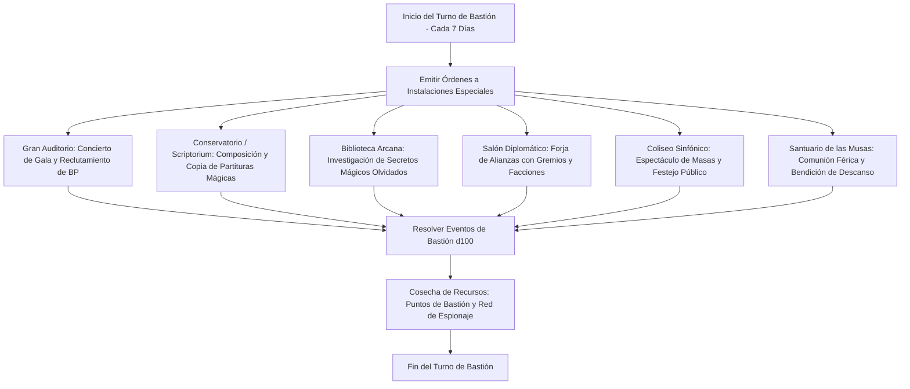

# 🏰 Bastión y Tiempo Muerto — The Conductor

## 🏰 Sistema de Bastiones (Reglas Oficiales DMG 2024 / D&D 5.5e)

* **Nombre del Bastión:** El Gran Teatro de la Sinfonía Eterna (The Eternal Symphony Theatre)
* **Nivel de Bastión:** 20 (Capacidad Máxima)
* **Puntos de Bastión (BP):** 100
* **Puntuación de Mando y Defensas (Defender Stats):**
  * STR 8 (-1), DEX 14 (+2), CON 16 (+3), INT 8 (-1), WIS 13 (+1), CHA 20 (+5)
  * **Bonificador de Defensa de Bastión:** $\mathbf{+11}$ (+6 Competencia + 5 Carisma)

---

## 🏛️ Registro de Instalaciones del Bastión (Nivel 20: 4 Roomy + 2 Vast)

### Instalaciones Básicas (Basic Facilities - Gratuitas e Ilimitadas)
1. **Dormitorio del Maestro de Capilla (Bedchambers):** Alcoba acústicamente aislada con terciopelo bermellón y cama con dosel.
2. **Comedor de Banquetes Sinfónicos (Dining Hall):** Salón con acústica impecable donde la orquesta y el personal cenan mientras ensayan cánones.
3. **Sala de Instrumentos Común (Common Room):** Taller y sala de afinación abierta para músicos, juglares y bardos errantes.
4. **Almacén de Escenografía y Archivo (Storage):** Espacio sellado para vestuario mágico, atriles encantados y rollos de partituras.

---

### Instalaciones Especiales (Special Facilities: Exactamente 6 al Nivel 20)

| Instalación | Tamaño (DMG 2024) | Nivel Mínimo | Estado | Orden Activa | Sinergia con el Build |
| :--- | :---: | :---: | :---: | :--- | :---: |
| **Gran Auditorio de Ensayo (Theater)** | **Roomy** | Nivel 5 | Activa (Maintain) | *Performance:* Organiza conciertos privados que generan 1d6 $\times$ 10 BP y reputación de élite. | 🔵 **Roto** |
| **Conservatorio de Escribanía (Scriptorium)** | **Roomy** | Nivel 5 | Activa (Maintain) | *Craft:* Transcribe pergaminos de *Silvery Barbs*, *Healing Word* y *Bless* a mitad de coste. | 🔵 **Roto** |
| **Biblioteca de Canciones Antiguas (Arcane Study)** | **Roomy** | Nivel 9 | Activa (Maintain) | *Research:* Desvela mitos arcanos y desbloquea opciones para *Magical Secrets*. | 🟢 **Excelente** |
| **Salón Diplomático de la Legión (Guildhall)** | **Roomy** | Nivel 13 | Activa (Maintain) | *Diplomacy:* Conecta con la red de espionaje del reino, obteniendo ventaja en pruebas de Carisma social. | 🟢 **Excelente** |
| **Gran Coliseo Sinfónico (Vast Theater)** | **Vast** | Nivel 13 | Activa (Maintain) | *Festival:* Reúne a multitudes masivas; neutraliza el descontento regional y suministra donaciones de oro. | 🔵 **Roto** |
| **Santuario de las Musas Silvestres (Sanctuary)** | **Vast** | Nivel 17 | Activa (Maintain) | *Empowerment:* Otorga a todo el grupo inspiración divina permanente y 50 THP tras un retiro de 24 horas. | 🔵 **Roto** |

---

## 👥 Guarnición y Personal de Mando (Staff & Garrison)

* **Mayordomo Mayor (Major Domo):** Barón Kaelen (Hobgoblin aristócrata y maestro de protocolo militar-artístico).
* **Guarnición Activa:**
  * 12 Guardias de Honor Hobgoblin con armaduras de desfile y alabardas resonantes.
  * 6 Arqueros con arcos largos que disparan flechas sonoras de señalización.
* **Personal Especialista:**
  * 1 Orquesta de Cámara de 8 Virtuosos (elfos, semielfos y humanos).
  * 1 Maestro Luthier especializado en madera encantada.
  * 1 Escribano Mayor de música arcana y sellos de encantamiento.

---

## ⏳ Actividades de Tiempo Muerto (Downtime Priorities)

### Prioridad 1: Producción Masiva de Pergaminos de Reacción (*Silvery Barbs*)
* **Objetivo:** Disponer de una reserva ilimitada de pergaminos de *Silvery Barbs* y *Bless*.
* **Mecánica:** Mediante el *Conservatorio de Escribanía*, fabricar pergaminos de nivel 1 por 25 po y 1 día de trabajo.
* **Ventaja Táctica:** Garantiza que en cada sesión el Conductor disponga de pergaminos de bolsillo listos para entregar a sus sirvientes o usar en momentos críticos sin tocar sus ranuras principales.

### Prioridad 2: Ensayos de Armonía de Escuadrón (Inspiring Leader Drills)
* **Objetivo:** Adiestrar a los compañeros de aventura en formaciones de reacción coordinadas.
* **Mecánica:** Utilizar la dote *Inspiring Leader* combinada con la acústica del *Gran Auditorio* para otorgar 25 THP a todo el pelotón antes de cada expedición.

### Prioridad 3: Diplomacia y Cooptación Política
* **Objetivo:** Controlar las cortes nobles y asambleas municipales mediante espectáculos que infunden sugestión mágica colectiva.
* **Mecánica:** Utilizar el *Coliseo Sinfónico* para presentar recitales de *Enthrall* y *Mass Suggestion*, inclinando votos de gobernantes y pacificando rebeliones.