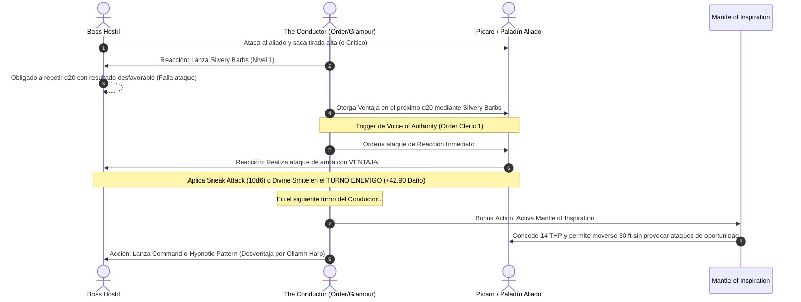

# 🌟 Lista de Conjuros Optimizada — The Conductor (Cleric 1 / Bard 19)

**Arquetipo:** Clérigo del Orden (*Order Domain*) & Bardo del Glamour (*College of Glamour*)  
**CD de Salvación de Bardo:** $8 + 6 \text{ (Prof)} + 5 \text{ (CAR)} = \mathbf{19}$ (Base) / $\mathbf{21}$ (Con *Reveler's Tambourine*)  
**CD de Salvación de Clérigo:** $8 + 6 \text{ (Prof)} + 1 \text{ (SAB)} = \mathbf{15}$  
**Efecto Pasivo Clave:** El instrumento legendario *Ollamh Harp* impone **Desventaja** a los enemigos en todas las tiradas de salvación contra tus conjuros de la escuela de **Encantamiento**.

---

## 🔮 Trucos (Cantrips)

### ⛪ Clérigo (3 Preparados)
1. **Guidance 🔵 [Pilar de Soporte]:** $+1\text{d}4$ a cualquier prueba de habilidad.
2. **Thaumaturgy 🟡 [Utilitario / Escénico]:** Amplifica la voz tres veces y abre puertas a distancia para entradas dramáticas.
3. **Mending 🟢 [Utilidad]:** Reparación de cuerdas de arpa, laúdes rotos y equipamiento de campaña.

### 🎭 Bardo (4 Conocidos)
1. **Vicious Mockery 🟢 [Debuff Ofensivo]:** $4\text{d}4$ de daño psíquico e impone Desventaja en el siguiente ataque del enemigo.
2. **Minor Illusion 🟢 [Control Visual]:** Crea atriles, sonidos orquestales o cobertura ilusoria.
3. **Message 🟡 [Comunicación]:** Envío de órdenes tácticas secretas a través del campo.
4. **Prestidigitation 🟡 [Utilidad]:** Efectos sensoriales, luces rítmicas y ambientación.

---

## ⛪ Conjuros Preparados de Clérigo (Order Domain 1)

* **Conjuros de Dominio (Siempre Preparados):**
  * **Command 🔵 [Control Absoluto]:** Obliga a los objetivos a *Grovel* (tirarse boca abajo otorgando ventaja cuerpo a cuerpo) o *Drop* (soltar armas). Con *Ollamh Harp*, tiran con Desventaja.
  * **Heroism 🟢 [Buffer Anti-Miedo]:** Inmunidad a asustado y THP continuos por asalto.
* **Conjuros Diarios Preparados (Sabiduría + Nivel = 2):**
  * **Bless 🔵 [Disparador de Ataque]:** $+1\text{d}4$ a ataques y salvaciones de 3 aliados. Al lanzarlo, activa **Voice of Authority** para que uno de ellos realice un ataque de reacción inmediato.
  * **Healing Word 🔵 [Rescate Táctico]:** Acción adicional a 60 pies. Levanta a un aliado a 0 HP y le concede un ataque de reacción inmediato para vengarse antes de su turno.

---

## 🎭 Matriz de Conjuros de Bardo (19 Conocidos + Secretos Mágicos)

### 9.º Nivel (1 Ranura)
* **Wish 🔵 [Omnipotencia Arcana — Secreto Mágico Nivel 18]:** Replica cualquier conjuro de nivel 1-8 sin componentes materiales ni tiempo prolongado.
* **Mass Heal 🔵 [Sanación Absoluta — Secreto Mágico Nivel 18]:** Restaura hasta **700 Puntos de Golpe** distribuidos libremente entre el equipo y cura todas las enfermedades y cegueras.

### 8.º Nivel (1 Ranura)
* **Mind Blank 🔵 [Blindaje Mental Total]:** 24 horas de inmunidad absoluta contra daño psíquico, lecturas mentales, adivinación y efectos de encantamiento sin concentración.

### 7.º Nivel (2 Ranuras)
* **Forcecage 🔵 [Prisión Indestructible]:** Encierra a jefes o colosos en una jaula de fuerza de 20 pies sin tirada de salvación y sin concentración.
* **Mirage Arcane 🟢 [Reescritura de Realidad]:** Altera 1 milla cuadrada de terreno durante 10 días, creando fortalezas, fosos de lava o laberintos con tacto físico real.

### 6.º Nivel (1 Ranura)
* **Heroes' Feast 🔵 [Banquete de Élite]:** Cura enfermedades, confiere inmunidad al veneno y al miedo, ventaja en salvaciones de Sabiduría y $+2\text{d}10$ a la vida máxima durante 24 horas.
* **Otto's Irresistible Dance 🔵 [Incapacitación Automática]:** Fuerza al objetivo a bailar de inmediato sin salvación inicial; gasta sus acciones, sufre Desventaja en ataques y concede Ventaja a tus aliados.

### 5.º Nivel (2 Ranuras)
* **Synaptic Static 🟢 [Bomba Psíquica]:** $8\text{d}6$ de daño en área de 20 pies; resta $1\text{d}6$ a todas las tiradas de ataque y salvación enemigas durante 1 minuto sin concentración.
* **Hold Monster 🟢 [Parálisis de Jefes]:** Paraliza a un monstruo para regalar golpes críticos automáticos a todos los aliados a 5 pies.
* **Greater Restoration 🟢 [Utilidad Vital]:** Neutraliza petrificaciones, agotamiento y reducciones de características.

### 4.º Nivel (3 Ranuras)
* **Dimension Door 🟢 [Evacuación Táctica]:** Teletransporte de 400 pies con un compañero sin requerir línea de visión.
* **Polymorph 🟢 [Soporte Versátil]:** Transforma a un aliado en apuros en un T-Rex o incapacita a un enemigo peligroso.
* **Find Greater Steed 🔵 [Pegaso / Grifo — Secreto Mágico Nivel 10]:** Montura aérea inteligente que duplica cualquier conjuro que te lances a ti mismo (como *Bless* o *Aid*).

### 3.ᵉʳ Nivel (3 Ranuras)
* **Counterspell 🔵 [Defensa Arcana — Secreto Mágico Nivel 10]:** Interrumpe y cancela conjuros hostiles en 60 pies.
* **Hypnotic Pattern 🔵 [Control Masivo]:** Incapacita a salas enteras de enemigos (tirada de Sabiduría con Desventaja impuesta por *Ollamh Harp*).
* **Haste 🔵 [Buff Marcial Supremo]:** Concede al Paladín o Fighter velocidad duplicada, $+2$ CA y un ataque extra; activa inmediatamente un ataque de reacción vía *Voice of Authority*.

### 2.º Nivel (3 Ranuras)
* **Aid 🔵 [Buffer Colectivo]:** Aumenta los HP máximos y actuales de 3 aliados en $+5$ por nivel de ranura (upcast a Nivel 7: $+30$ HP máximos a 3 aliados) y activa *Voice of Authority*.
* **Misty Step 🔵 [Movilidad Instantánea — Fey Touched]:** Teletransporte de 30 pies como acción adicional.
* **Hold Person 🟢 [Parálisis Humanoides]:** Críticos automáticos para el escuadrón contra humanoides.

### 1.ᵉʳ Nivel (4 Ranuras)
* **Silvery Barbs 🔵 [El Motor del Build — Fey Touched / Bardo]:** Desventaja forzada a un enemigo que impacta $\rightarrow$ Ventaja concedida a un aliado $\rightarrow$ activa *Voice of Authority* para otorgarle un ataque de reacción inmediato con ventaja.
* **Dissonant Whispers 🟢 [Forzador de Oportunidad]:** Inflige daño psíquico y obliga al enemigo a huir usando su reacción, provocando ataques de oportunidad de todo tu pelotón cuerpo a cuerpo.

---

## ⚡ Diagrama de Secuencia de la Orquestación de Reacción

---

## 🩺 Curación en Segundo Plano y Amortiguación Táctica (Background Healing)

The Conductor no cura reactivamente; crea una armadura de amortiguación constante que hace imposible que el escuadrón sufra daño real:

1. **Inyección Rítmica de Vida Temporal (*Mantle of Inspiration*):**
   * Como Acción Adicional, otorga **14 THP** a hasta **5 aliados** simultáneamente ($70 \text{ THP colectivos}$).
   * Puede realizarse **5 veces por Descanso Corto** gracias a *Font of Inspiration*, totalizando $\mathbf{350 \text{ THP de absorción}}$ disponibles cada hora de pausa.
2. **Buffer Matutino de Salud (*Inspiring Leader* + *Aid* + *Heroes' Feast*):**
   * *Heroes' Feast:* $+2\text{d}10$ de vida máxima y ventaja en salvaciones mentales a todo el grupo por 24 horas.
   * *Aid (Upcast a Nivel 7 u 8):* $+30$ a $+35$ puntos de vida máxima permanente a 3 aliados clave (Fighter, Paladín, Conductor).
   * *Inspiring Leader:* $+25$ THP adicionales a 6 aliados tras cada descanso corto.
   * **Total de vida preventiva antes de entrar en combate:** Más de **250 puntos de salud amortiguada** protegiendo a los combatientes.
3. **Levantamiento Ofensivo (*Healing Word* + *Voice of Authority*):**
   * Si un aliado cae a 0 HP, una simple *Healing Word* de nivel 1 como Acción Adicional lo devuelve al combate a 60 pies de distancia y le permite asestar un ataque de arma inmediato contra el agresor que lo derribó antes de que termine la ronda.
4. **Reseteo Nuclear (*Mass Heal* — Nivel 18):**
   * Si una catástrofe planar o aliento de dragón múltiple hiere a todo el escuadrón, *Mass Heal* distribuye **700 puntos de golpe netos**, reponiendo a todo el grupo a su salud máxima en un solo turno.