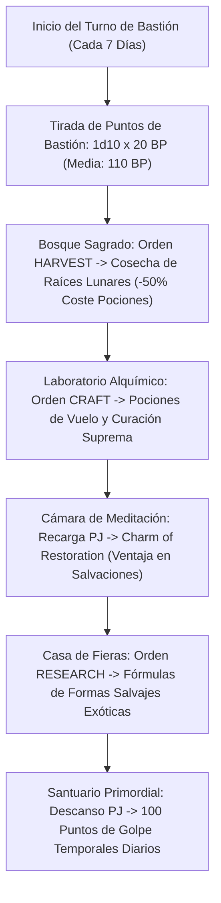

# 🏰 Bastión y Tiempo Muerto — The Cursed Moon Druid

## 🏰 Sistema de Bastiones (Reglas Oficiales 2024 / 5.5e DMG)

*Estructura de gestión de la base de operaciones, automatización de turnos de bastión y mecánicas de mando del personaje a Nivel 20.*

* **Nombre del Bastión:** El Enclave de la Luna Maldita (The Cursed Grove Sanctum)
* **Nivel de Bastión (Bastion Level):** 20 (Nivel Máximo)
* **Puntos de Bastión (Bastion Points - BP):** 450 BP acumulados
* **Puntuación de Mando (Bastion Defender Stats):** 
  * STR 8 (-1) | DEX 14 (+2) | CON 16 (+3) | INT 8 (-1) | **WIS 20 (+5)** | CHA 13 (+1)
  * Modificador de Mando Primario: **+5 (Sabiduría) + 6 (PB) = +11**

---

### Instalaciones Básicas (Basic Facilities — Oficiales DMG 2024)

*Instalaciones comunes sin coste de ranura especial según la DMG 2024:*

1. **Dormitorio Principal (Bedchambers):** Aposentos personales integrados en el tronco hueco de un roble milenario sagrado protegido por glifos druídicos.
2. **Comedor (Dining Hall):** Salón comunal tallado en madera viva con capacidad para 30 druidas, exploradores y diplomáticos de la naturaleza.
3. **Espacio Común (Common Room):** Ágora natural al aire libre rodeada de megalitos para la meditación, asambleas lunares y estudio estelar.
4. **Cocina y Granero Natural (Kitchen & Granary):** Silo de semillas sagradas y bayas preservadas para alimentar a la guarnición y resistir asedios prolongados.

---

### Instalaciones Especiales Optimizadas (6 Especiales RAW: 4 Roomy + 2 Vast)

*El sistema oficial otorga exactamente **6 Instalaciones Especiales** a Nivel 20 (4 Espaciosas + 2 Extensas). Su selección maximiza la destilación de consumibles de vanguardia, la adquisición de formas salvajes y el blindaje de EHP:*

* **1. Bosque Sagrado (Sacred Grove) — [Oficial DMG 2024 — Nivel 5] [Espaciosa / Roomy]:**
  * *Estado:* Activa (Orden: **Harvest / Craft**)
  * *Prerrequisito Oficial:* Rasgo de Druida o Lanzador de Conjuros Primordiales.
  * *Personal Asignado:* 1 Druida Guardián del Círculo.
  * *Beneficio Pasivo Oficial:* Cosecha de raíces lunares y hierbas sagradas que **reducen el coste de fabricación de *Potions of Healing* y focos druídicos a la mitad**.
  * *Sinergia con el Build:* 🔵 **Indispensable**. Abarata al 50% la producción de pociones curativas y catalizadores vegetales para todo el grupo.

* **2. Laboratorio Alquímico (Laboratory) — [Oficial DMG 2024 — Nivel 5/9] [Espaciosa / Roomy]:**
  * *Estado:* Activa (Orden: **Craft**)
  * *Prerrequisito Oficial:* Ninguno.
  * *Personal Asignado:* 1 Maestro Alquimista y Herbalista.
  * *Orden de Bastión Oficial:* **Craft (Pociones Tácticas y Elixires).**
  * *Sinergia con el Build:* 🔵 **Roto/Indispensable**. Genera consumibles de combate vitales:
    1. **Pociones de Vuelo (*Potion of Flying*):** Concede 60 pies de vuelo durante 1 hora **sin requerir concentración**, permitiendo volar en Forma Salvaje de criaturas terrestres de gran potencia (Oso Polar, Mamut) sin gastar ranura ni concentración en *Fly*.
    2. **Pociones de Curación Suprema ($10\text{d}4 + 20$ HP):** En las reglas 2024 (5.5e), beber una poción propia es una **Acción Adicional**, permitiendo restaurar salud en combate sin perder la Acción de ataque en Forma Salvaje.

* **3. Círculo de Teletransporte (Teleportation Circle) — [Oficial DMG 2024 — Nivel 9] [Espaciosa / Roomy]:**
  * *Estado:* Activa (Orden: **Maintain**)
  * *Prerrequisito Oficial:* Rasgo *Spellcasting*.
  * *Personal Asignado:* 1 Guardián del Vórtice Rúnico.
  * *Orden de Bastión Oficial:* **Maintain (Enlace de Tránsito Planar).**
  * *Sinergia con el Build:* 🔵 **Indispensable**. Alberga un círculo permanente de sigilos grabado en un anillo de menhires. Conecta el enclave a la red global de círculos druídicos del multiverso (*Transport via Plants* o *Teleportation Circle*).

* **4. Casa de Fieras y Hábitat Primigenio (Menagerie) — [Oficial DMG 2024 — Nivel 9/13] [Espaciosa / Roomy]:**
  * *Estado:* Activa (Orden: **Harvest / Research**)
  * *Prerrequisito Oficial:* Ninguno.
  * *Personal Asignado:* 1 Rastreador y Zoólogo Maestro.
  * *Orden de Bastión Oficial:* **Research (Estudio de Bestias Antiguas y Formas Salvajes).**
  * *Sinergia con el Build:* 🔵 **Roto para Círculo de la Luna**. Alberga ejemplares vivos y fósiles de dinosaurios, depredadores gigantescos y bestias de la tundra. Provee el requisito de haber "visto a la criatura" para transformarse en cualquier bestia de FP permitido por las reglas del Círculo de la Luna 2024.

* **5. Cámara de Meditación (Meditation Chamber) — [Oficial DMG 2024 — Nivel 13] [Extensa / Vast]:**
  * *Estado:* Activa (Orden: **Empower**)
  * *Prerrequisito Oficial:* Ninguno.
  * *Personal Asignado:* 1 Maestro Contemplativo.
  * *Beneficio Pasivo Oficial:* Al completar un Descanso Largo en su interior, concede el **Talismán de Restauración (*Charm of Restoration*)**, que otorga **Ventaja en tiradas de salvación de Constitución o Sabiduría** durante 7 días o permite lanzar *Lesser Restoration* sin gastar ranuras.
  * *Sinergia con el Build:* 🔵 **Roto**. Convierte la concentración del Druida en un muro matemáticamente impenetrable frente al fuego concentrado enemigo.

* **6. Santuario del Vórtice Primordial (Sanctum / Demiplane) — [Oficial DMG 2024 — Nivel 17] [Extensa / Vast]:**
  * *Estado:* Activa (Orden: **Maintain**)
  * *Prerrequisito Oficial:* Lanzador de Conjuros de Nivel 17+.
  * *Personal Asignado:* 1 Alto Jerarca de la Naturaleza.
  * *Beneficio Pasivo Oficial:* Concede **100 Puntos de Golpe Temporales** diarios tras realizar un Descanso Largo en el santuario, además de inmunidad frente a conjuros de adivinación hostiles.
  * *Sinergia con el Build:* 🔵 **EHP Colosal**. Eleva la reserva de vida efectiva pre-combate a **387 EHP**, permitiendo absorber el primer asalto enemigo sin activar aún *Armor of Agathys*.

---

## ⚡ Protocolo de Automatización del Turno de Bastión (Weekly Routine)

### 1. Tabla de Producción Semanal de Consumibles Tácticos

| Instalación | Orden Asignada | Producto Semanal Obtenido | Utilidad Táctica META |
| :--- | :---: | :--- | :--- |
| **Bosque Sagrado** | Harvest | 2x Lotes de Hierbas Sagradas | Reduce a la mitad el coste de diamantes/oro para consumibles de salud. |
| **Laboratorio** | Craft | 1x *Potion of Flying* o *Supreme Healing* | 60 ft de vuelo sin concentración para Forma Salvaje o sanación de $10\text{d}4 + 20$ en Acción Adicional. |
| **Cámara Meditación**| Empower | 1x *Charm of Restoration* | Ventaja en tiradas de salvación de concentración durante 7 días. |
| **Casa de Fieras** | Research | Estudio de Anatomía Bestial | Desbloqueo de formas salvajes gigantes y elementales exóticos. |
| **Santuario** | Descanso PJ | **100 Temp HP Diarios** | Depósito masivo de vida temporal para vanguardia. |

---

## 🛡️ Mecánicas de Defensa, Guarnición y Resolución de Asedios

### 1. Estadísticas de Defensa del Bastión
* **Puntuación de Mando (Defender Rating):**
  $$\text{Modificador de Mando} = \text{Bono de Competencia (+6)} + \text{Modificador de Sabiduría (+5)} = \mathbf{+11}$$
* **Guarnición Activa Permanente:**
  * **12 Treants Jóvenes y Guardianes Silvanos:** Defensores acorazados de corteza viva armados con ramas de roble sagrado y hondas de proyectiles mágicos.
  * **Aura de Luz Tenue Permanente (*Twilight Sanctuary*):** El santuario proyecta penumbra reconfortante que desorienta a invasores y otorga Puntos de Golpe Temporales a los defensores en cada asalto.

### 2. Red de Protección Primordial
1. **Red de Glifos Lunares (*Glyphs of Warding*):** Enlazados en las entradas del Círculo de Teletransporte para activar *Dispel Magic* y *Moonbeam 8.º* contra intrusos no autorizados.
2. **Raíces de Guarda (*Plant Growth* Permanente):** El terreno exterior al enclave cuesta 4 pies de movimiento por cada pie recorrido, haciendo los asedios terrestres virtualmente imposibles.

---

## ⏳ Actividades de Tiempo Muerto (Downtime Activities)

### Prioridad 1: Destilación de Pociones de Vuelo y Sanación Rápida
* **Mecánica:** DMG 2024 + Kit de Herbalismo / Suministros de Alquimista $+11$.
* **Objetivo:** Garantizar un stock inagotable de Pociones de Vuelo para dotar de movilidad aérea tridimensional a la Forma Salvaje sin consumir la concentración del Druida.

### Prioridad 2: Expediciones Salvajes y Acumulación de Formas Lunares
* **Mecánica:** Estudio biológico en la Casa de Fieras y expediciones a planos primigenios.
* **Objetivo:** Registrar variantes anatómicas de depredadores de FP alto para desplegar ataques de mordisco, derribo o agarre táctico según el combate.

---

## 🏃‍♂️ Modos de Movimiento, Logística y Despliegue

* **Caminar (Walk):** 30 pies (Humano) / 40 a 60 pies (Forma Salvaje de Felino o Bestia).
* **Trepar (Climb):** 30 pies (Forma Salvaje).
* **Nadar (Swim):** 60 pies (Forma Salvaje marina).
* **Volar (Fly):** 80 pies (Forma Salvaje aérea a Nivel 9+) o 60 pies (con *Potion of Flying* sin concentración).
* **Capacidad de Carga:** 120 lbs humano / hasta 1,200 lbs en Forma Salvaje de criatura Grande o Enorme.
