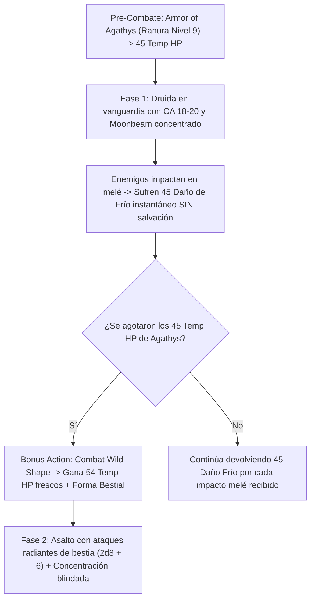

# Resumen General del Personaje: The Cursed Moon Druid

## 📊 Datos Generales

* **System Standard:** D&D 5th Edition (2024 / 5.5e Update)
* **Character Level:** 20 (Druid [Circle of the Moon] 18 / Warlock [Fiend] 1 / Cleric [Twilight Domain] 1)
* **Lanzador de Conjuros Unificado:** Nivel 20 (**Progresión Full Caster Integrada**)
* **Species:** Human (2024 PHB — Dote de Origen Adicional, Recurso Heroic Inspiration diario, Competencia adicional)
* **Background:** Guide (Dote de Origen: *Magic Initiate [Warlock]* — *Armor of Agathys*, *Eldritch Blast*, *Toll the Dead*)
* **Stats Finales (Point Buy + Background + Dotes + ASI):**
  * **STR:** 8 (-1) *(Point Buy: 8)*
  * **DEX:** 14 (+2) *(Point Buy: 14)*
  * **CON:** 16 (+3) *(Point Buy: 15 + 1 Resilient CON)*
  * **INT:** 8 (-1) *(Point Buy: 8)*
  * **WIS:** 20 (+5) *(Point Buy: 15 + 2 Background + 1 Telekinetic [WIS] + 2 ASI Nivel 14)*
  * **CHA:** 13 (+1) *(Point Buy: 13 — Requisito de Multiclaseo Warlock)*

---

### 📂 Enlaces Directos del Expediente
* 🏰 **Bastión y Tiempo Muerto:** [`bastion and downtime.md`](file:///d:/repo-vault/Proyectos/Rol/DnDbuilds/builds/the%20cursed%20moon%20druid%20unlocking%20the%20potential%20of%20the%20moon%20druid%20in%20dd%2055/bastion%20and%20downtime.md)
* ⚡ **Lista de Conjuros Optimizada:** [`spell list.md`](file:///d:/repo-vault/Proyectos/Rol/DnDbuilds/builds/the%20cursed%20moon%20druid%20unlocking%20the%20potential%20of%20the%20moon%20druid%20in%20dd%2055/spell%20list.md)
* 🎒 **Inventario Actual:** [`actual inventory list.md`](file:///d:/repo-vault/Proyectos/Rol/DnDbuilds/builds/the%20cursed%20moon%20druid%20unlocking%20the%20potential%20of%20the%20moon%20druid%20in%20dd%2055/actual%20inventory%20list.md)
* 🎯 **Objetos a Obtener por Tiers:** [`item list to obtain.md`](file:///d:/repo-vault/Proyectos/Rol/DnDbuilds/builds/the%20cursed%20moon%20druid%20unlocking%20the%20potential%20of%20the%20moon%20druid%20in%20dd%2055/item%20list%20to%20obtain.md)
* 🗺️ **Hoja de Ruta Nivel a Nivel (1-20):** [`roadmap.md`](file:///d:/repo-vault/Proyectos/Rol/DnDbuilds/builds/the%20cursed%20moon%20druid%20unlocking%20the%20potential%20of%20the%20moon%20druid%20in%20dd%2055/roadmap.md)

---

### 🛡️ Arsenal e Inventario Sintonizado (3/3 Ranuras Activas)

1. **Moon Sickle (+3) (Muy Raro — Sintonizado 1/3) 🔵 [Foco Universal Único]:**
   * $+3$ a tiradas de ataque de conjuro y a la CD de salvación de conjuros de Druida.
   * Concede $+1\text{d}4$ de curación adicional a cualquier conjuro restaurativo.
   * Canaliza todos los conjuros divinos, arcanos y de pacto sin penalización somática, incluso durante la Forma Salvaje.
2. **Cloak of Protection (Poco Común — Sintonizado 2/3) 🟢:**
   * $+1$ a la Clase de Armadura y $+1$ a todas las Tiradas de Salvación. Permanece activo y adaptado en Forma Salvaje.
3. **Ring of Protection (Raro — Sintonizado 3/3) 🟢:**
   * $+1$ a la Clase de Armadura y $+1$ a todas las Tiradas de Salvación (acumulable con la Capa para un $+2$ pasivo total a CA y TS).
4. **Insignia of Claws (Poco Común — Sin Sintonización) 🔵 [Esencial Forma Salvaje]:**
   * Transforma los ataques desarmados y de bestia de la Forma Salvaje en mágicos, otorgando $+1$ al impacto y daño.
5. **Sentinel Shield (Poco Común — Sin Sintonización):**
   * Ventaja constante en tiradas de Iniciativa y pruebas de Percepción mientras se empuña en forma humanoide.

---

## ⚔️ Combat Role: Vanguard Tank, Cold Retaliation Striker & Battlefield Dominator

### 1. Gestión de Recursos y Reglas de la Mesa

* **Foco Universal Único (Regla de Mesa):** El *Moon Sickle (+3)* o símbolo druídico consagrado canaliza la totalidad de conjuros de Druida, Warlock y Clérigo. Elimina requisitos de manos libres y componentes somáticos/materiales sin coste en oro tanto en forma humanoide como durante la **Forma Salvaje (Wild Shape)**.
* **Progresión Full Caster Integrada (Regla de Oro):** Con 18 niveles de Druida, 1 de Warlock y 1 de Clérigo, la suma de niveles de lanzador unificada es **20**. El personaje dispone del árbol completo de espacios de conjuro de nivel 1 a 9 y prepara conjuros de 9.º nivel de Warlock (*Armor of Agathys*) y Druida (*Shapechange*, *Foresight*).
* **El Motor Escalonado de EHP (Escudo de Venganza de Agathys + Combat Wild Shape):**
  * *Resolución de Reglas (Temp HP Stacking):* Las reglas oficiales prohíben acumular Puntos de Golpe Temporales simultáneos. Por tanto, el motor opera como un **sistema de absorción por capas escalonadas**:
    1. **Capa 1 (El Puercoespín Glacial):** Se lanza *Armor of Agathys* a 9.º Nivel (45 Temp HP). En melé, cada enemigo que impacta al Druida sufre **45 de daño de frío instantáneo sin tirada de salvación**.
    2. **Capa 2 (Metamorfosis Bestial Inmediata):** En cuanto los 45 Temp HP de *Agathys* se extinguen, el Druida activa *Combat Wild Shape* como **Acción Adicional**, obteniendo **54 Puntos de Golpe Temporales frescos** de Forma Salvaje y fijando su CA en **20 CA** ($13 + 5_{\text{WIS}} + 2_{\text{Items}}$) sin tocar sus 153 HP base.

---

### 2. Action Economy & Combat Loop

* **Pre-combat / Turno 0 Setup:**
  * **Lanzamientos Pasivos (Sin Concentración):** *Armor of Agathys* (9.º Nivel — 45 Temp HP + 45 Daño de Frío de Venganza), *Aid* (8.º Nivel — +35 HP máximos a 3 criaturas), *Death Ward* (4.º Nivel — prevención de muerte súbita).
  * **Iniciativa Táctica:** Ventaja en Iniciativa (*Sentinel Shield*) y bono por *Vigilant Blessing* (Clérigo Twilight) asignable al Druida o a un aliado.
* **Turno 1 Setup (Posicionamiento y Castigo):**
  * **Action:** Lanzar *Moonbeam* concentrado a 8.º Nivel ($8\text{d}10$ radiante) o *Spike Growth* para control de terreno.
  * **Bonus Action:** Posicionamiento con *Telekinetic* (empujar a un enemigo prioritario 5 ft hacia el vórtice de daño) o *Combat Wild Shape* si el daño entrante ya consumió la primera capa de Agathys.
  * **Reaction:** *Absorb Elements* (mitigar daño elemental entrante a la mitad, extendiendo la vida útil de los 45 Temp HP de *Agathys*).
* **Turnos 2+ (Bucle de Desgaste y Dominación):**
  * **Action:** Ataques con Forma Salvaje (2 ataques desarmados con daño radiante en 2024, sumando $+1$ de *Insignia of Claws* y $+5$ de Sabiduría) o mover *Moonbeam* a un nuevo grupo de enemigos.
  * **Bonus Action:** Reconvertir ranuras de conjuro en Puntos de Golpe de Forma Salvaje mediante *Combat Wild Shape* o empujón telequinético.
  * **Reaction:** *Shield* (vía pergaminos/alianzas) o *Absorb Elements*.
* **Post-Combate / Entre Encuentros (Reset Exprés 2024):**
  * *Prayer of Healing* (2.º Nivel — 10 minutos) para otorgar un **Descanso Corto** a todo el grupo, recuperando los 2 usos de Forma Salvaje y permitiendo gastar dados de golpe.

---

## 3. The META Combo: El Motor Escalonado de Agathys y Forma Salvaje

### 🧮 Mathematical Engine (D&D 5e 2024 / 5.5e)

$$\text{Daño de Retaliación Glacial Total} = N_{\text{Impactos melé}} \times \mathbf{45\text{ Daño de Frío Plano (Sin Salvación)}}$$

* Si 4 enemigos impactan al Druida antes de drenar los 45 Temp HP (apoyado por *Absorb Elements* o resistencia):
  $$\text{Daño Devuelto por Agathys} = 4 \times 45 = \mathbf{180\text{ Daño Frío Garantizado}}$$

$$\text{DPR Sostenido en Forma Salvaje (Nivel 20)} = 2 \times \left[ P(\text{Impacto}) \times (2\text{d}8_{\text{Bestia}} + 5_{\text{WIS}} + 1_{\text{Insignia}}) \right] + P(\text{Moonbeam}) \times 8\text{d}10_{\text{Radiante}}$$

$$\text{Pool Total de EHP Escalonado} = 153_{\text{HP Base}} + 45_{\text{Agathys}} + 54_{\text{Wild Shape}} + 35_{\text{Aid (Nv 8)}} + 100_{\text{Bastion}} = \mathbf{387\text{ EHP Efectivo}}$$

---

## 4. Tabla de Rendimiento Táctico

| Criterio | Valoración | Justificación Mecánica |
| :--- | :---: | :--- |
| **Daño Monobjetivo** | 🔵 | *Armor of Agathys 9.º* devuelve 45 de daño de frío por golpe sin salvación, sumado a los ataques radiantes de Forma Salvaje y *Moonbeam 8.º*. |
| **Control de Masas (CC)** | 🔵 | Catálogo de élite: *Spike Growth*, *Plant Growth*, *Wall of Thorns*, *Reverse Gravity* y empujones telequinéticos en Acción Adicional. |
| **Supervivencia (EHP)** | 🔵 | **387 EHP escalonado**, CA 20 en forma bestial, salvaciones de CON con +9 y Ventaja (*War Caster*), y *Death Ward* pasivo. |
| **Economía de Acciones** | 🔵 | Transformación y telequinesis en Acción Adicional, control/ataques en Acción principal y mitigación reactiva elemental. |
| **Sustentabilidad** | 🔵 | Recuperación de usos de Forma Salvaje en descansos cortos de 10 min (*Prayer of Healing* 2024) y regeneración de recursos divinos/primordiales. |

---

## 5. Home Rules (Reglas de la Mesa)

1. **Foco Universal Único:** El *Moon Sickle* o reliquia sagrada canaliza indistintamente conjuros de Druida, Warlock y Clérigo en forma humana y en Forma Salvaje sin restricciones de componentes somáticos o materiales sin coste en oro.
2. **Progresión Full Caster Integrada:** Nivel de lanzador total unificado de 20. Permite preparar conjuros de 9.º nivel de Druida y Warlock (*Armor of Agathys* a nivel 9).
3. **Absorción Escalonada de Puntos de Golpe Temporales:** Al extinguirse la reserva de *Armor of Agathys*, la activación de *Combat Wild Shape* renueva inmediatamente la reserva con 54 Temp HP sin interferir con la concentración.
