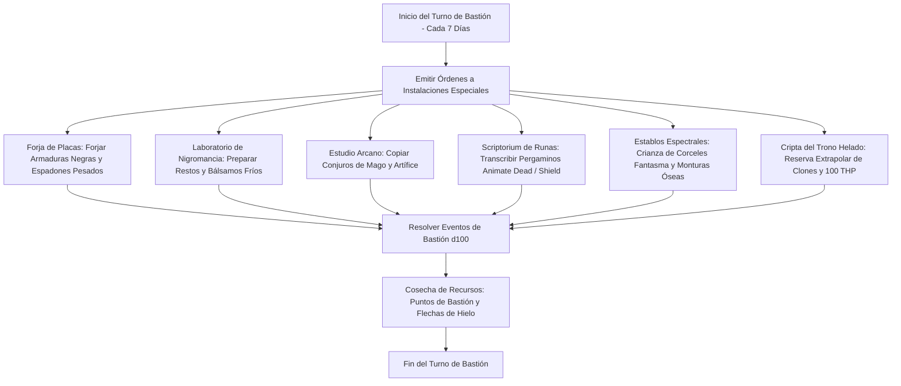

# 🏰 Bastión y Tiempo Muerto — Death Knight

## 🏰 Sistema de Bastiones (Reglas Oficiales DMG 2024 / D&D 5.5e)

* **Nombre del Bastión:** La Cripta de la Espada Helada (The Frostblade Crypt)
* **Nivel de Bastión:** 20 (Capacidad Máxima)
* **Puntos de Bastión (BP):** 100
* **Puntuación de Mando y Defensas (Defender Stats):**
  * STR 10 (+0), DEX 14 (+2), CON 16 (+3), INT 20 (+5), WIS 10 (+0), CHA 8 (-1)
  * **Bonificador de Defensa de Bastión:** $\mathbf{+11}$ (+6 Competencia + 5 Inteligencia)

---

## 🏛️ Registro de Instalaciones del Bastión (Nivel 20: 4 Roomy + 2 Vast)

### Instalaciones Básicas (Basic Facilities - Gratuitas e Ilimitadas)
1. **Camarote del Señor de la Muerte (Bedchambers):** Aposento de escarcha y piedra tallada con un lecho de basalto donde reposa la armadura de placas cuando no está en combate.
2. **Refectorio Helado (Dining Hall):** Sala comunal de granito donde la tripulación viva y artesanos consumen raciones y caldos calientes.
3. **Pabellón de Armas Común (Common Room):** Sala de adiestramiento marcial para afilar mandobles y calibrar autómatas mecánicos.
4. **Armería y Almacén Sellado (Storage):** Cripta climatizada a temperaturas bajo cero para conservar lingotes de hierro negro y huesos.

---

### Instalaciones Especiales (Special Facilities: Exactamente 6 al Nivel 20)

| Instalación | Tamaño (DMG 2024) | Nivel Mínimo | Estado | Orden Activa | Sinergia con el Build |
| :--- | :---: | :---: | :---: | :--- | :---: |
| **Forja de Hueso y Placas Rúnicas (Armory)** | **Roomy** | Nivel 5 | Activa (Maintain) | *Craft:* Forja y repara armaduras de placas completas y espadones con un 50% de descuento en tiempo y coste. | 🔵 **Roto** |
| **Laboratorio de Nigromancia (Laboratory)** | **Roomy** | Nivel 5 | Activa (Maintain) | *Research:* Preservación de cadáveres y síntesis de fluidos embalsamadores para *Clone*. | 🔵 **Roto** |
| **Estudio Arcano de Artífice (Arcane Study)** | **Roomy** | Nivel 5 | Activa (Maintain) | *Study:* Copiado de pergaminos arcanos y calibración de infusiones de Artífice. | 🟢 **Excelente** |
| **Scriptorium de Runas Negras (Scriptorium)** | **Roomy** | Nivel 9 | Activa (Maintain) | *Transcribe:* Copiado de pergaminos de *Animate Dead*, *Shield* y *Web* a velocidad duplicada. | 🟢 **Excelente** |
| **Establos Espectrales (Stable / Menagerie)** | **Vast** | Nivel 13 | Activa (Maintain) | *Mount:* Mantenimiento y custodia de monturas fantasma (*Phantom Steed*) y engendros no-muertos. | 🟢 **Excelente** |
| **Cripta del Trono Helado (Demiplane)** | **Vast** | Nivel 17 | Activa (Maintain) | *Sanctuary:* Reserva extradimensional inexpugnable; custodia 3 cámaras de *Clone* y suministra **100 THP de reposo**. | 🔵 **Roto** |

---

## 👥 Guarnición y Personal de Mando (Staff & Garrison)

* **Mayordomo Mayor (Major Domo):** Comandante Vane (Caballero espectral veterano de la orden caída).
* **Guarnición Activa:**
  * 16 Soldados Esqueléticos con cotas de placas y alabardas pesadas custodiando las almenas.
  * 8 Ballesteros Esqueleto en las troneras del bastión.
* **Personal Especialista:**
  * 1 Maestro Herrero de Guerra experto en aleaciones rúnicas de frío.
  * 1 Forense Alquímico para embalsamamiento y preparación de clones.
  * 1 Artífice Aprendiz para mantenimiento de constructos y de Boris the Bone Boar.

---

## ⏳ Actividades de Tiempo Muerto (Downtime Priorities)

### Prioridad 1: Mantenimiento de Receptáculos de Clonación (*Clone*)
* **Objetivo:** Custodiar 3 clones del Caballero de la Muerte en salmuera con espadones de repuesto.
* **Mecánica:** Mediante el *Laboratorio de Nigromancia* y la *Cripta del Trono Helado*, mantener los receptáculos listos para resurrección inmediata.
* **Ventaja Táctica:** Garantiza que si el Caballero es abatido en primera línea, su alma despierte viva y lista para el combate en el Bastión sin pérdida de niveles.

### Prioridad 2: Forja de Armamento para la Horda Esquelética
* **Objetivo:** Equipar a los 16 arqueros esqueleto con arcos reforzados y flechas de hierro frío.
* **Mecánica:** Trabajos en la *Forja de Placas* con herramientas de herrero (Inteligencia $+11$).

### Prioridad 3: Calibración y Blindaje de Boris the Bone Boar
* **Objetivo:** Reforzar el chasis óseo del Defensor de Acero con placas de hierro negro y runas de desvío de ataques.
* **Mecánica:** Sesiones de mejora mecánica en el *Estudio Arcano de Artífice*.