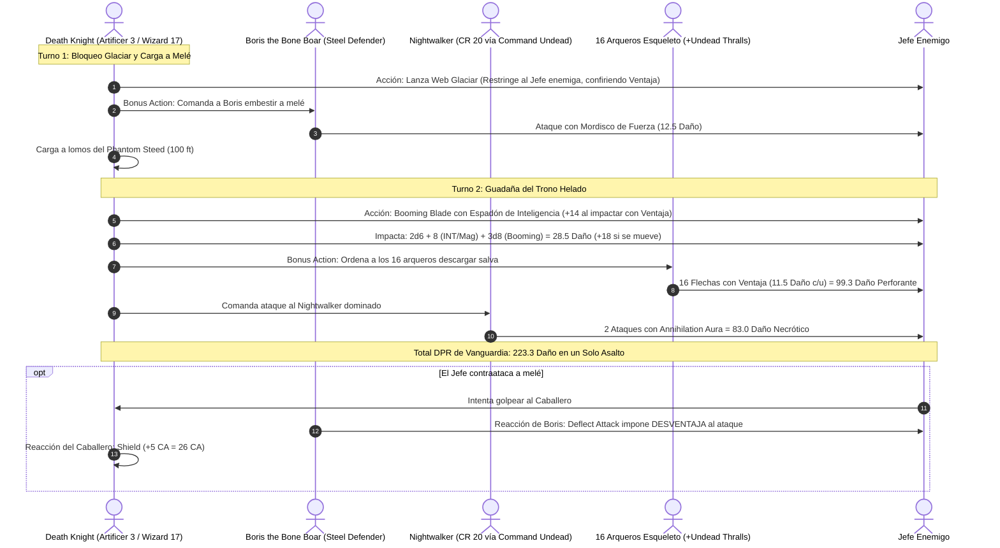

# 🌟 Lista de Conjuros Optimizada — Death Knight (Artificer 3 / Wizard 17)

**Arquetipo:** Herrero de Batalla (*Battle Smith*) & Nigromancia (*School of Necromancy*)  
**CD de Salvación de Conjuros:** $8 + 6 \text{ (Prof)} + 5 \text{ (INT)} = \mathbf{19}$ (Base) / $\mathbf{22}$ (Con *Staff of the Magi*)  
**Modificador de Ataque Mágico y Melee:** $+11$ (Base) / $\mathbf{+14}$ (Con espadón / bastón $+3$)  

---

## 🔮 Trucos (Cantrips)

### 🛠️ Artífice (2 Conocidos)
1. **Mending 🔵 [Reparación de Boris]:** Repara $2\text{d}6$ Puntos de Golpe al Defensor de Acero (*Boris*) a voluntad fuera de combate sin coste de ranuras.
2. **Guidance 🔵 [Pilar de Apoyo]:** $+1\text{d}4$ a pruebas de habilidad o iniciativas.

### 🧙‍♂️ Mago (5 Conocidos)
1. **Booming Blade 🔵 [Pilar Melee de Vanguardia]:** Ataque con espadón usando Inteligencia; inflige $+3\text{d}8$ daño de trueno extra y $+4\text{d}8$ si el enemigo se mueve.
2. **Green-Flame Blade 🟢 [Ataque Multiobjetivo]:** Daño secundario de fuego ($3\text{d}8 + 5$) a un segundo objetivo adyacente.
3. **Toll the Dead 🟢 [Ejecución a Distancia]:** $4\text{d}12$ de daño necrótico a enemigos heridos.
4. **Mind Sliver 🟢 [Debuff Mental]:** $4\text{d}6$ psíquico y resta $1\text{d}4$ a la próxima tirada de salvación del enemigo.
5. **Prestidigitation 🟡 [Utilidad]:** Efectos menores de ambientación fúnebre.

---

## 🛠️ Conjuros Preparados de Artífice (Battle Smith 3 — 3 Diarios + Conjuros de Subclase)

* **Conjuros de Subclase Battle Smith (Siempre Preparados):**
  * **Heroism 🟢:** Inmunidad al miedo y THP continuos en primera línea.
  * **Shield 🔵 [Defensa Suprema]:** Reacción inmediata que otorga $+5$ a la CA (alcanzando CA 26).
* **Conjuros Diarios de Artífice:**
  * **Absorb Elements 🔵 [Defensa Elemental]:** Reacción para ganar resistencia a daño elemental y sumar $+1\text{d}6$ a tu próximo ataque de espadón.
  * **Faerie Fire 🟢 [Ventaja Grupal]:** Cubre un área de 20 pies para conceder Ventaja constante a ti y a tus esqueletos.
  * **Cure Wounds 🟡 [Rescate de Emergencia]:** Cura $1\text{d}8 + 5$ en caso de apuro extremo.

---

## 🧙‍♂️ Matriz de Conjuros de Mago Preparados (Nigromancia 17 — 22 Conjuros Diarios)

### 9.º Nivel (1 Ranura)
* **Wish 🔵 [Omnipotencia Arcana]:** Duplica cualquier conjuro de nivel 1-8 existente en el juego (*Heroes' Feast*, *Simulacrum* instantáneo) sin consumir componentes materiales ni tiempo prolongado.

### 8.º Nivel (1 Ranura)
* **Create Undead (Upcast Nivel 8) 🔵 [Guardia Real Ghasts]:** Controla **10 Ghasts** con garras paralizantes y auras de hedor para escoltar tu vanguardia.
* **Clone 🔵 [Inmortalidad en Cripta]:** Fabricación de clones en salmuera custodiados en el Bastión.

### 7.º Nivel (2 Ranuras)
* **Simulacrum 🔵 [Duplicado de Batalla]:** Crea una réplica exacta de ti mismo para duplicar la potencia del espadón y los comandos de la horda.
* **Finger of Death 🟢 [Ejecución y Alistamiento]:** $7\text{d}8 + 30$ de daño necrótico; si mata al humanoide, lo alza permanentemente como zombi leal.

### 6.º Nivel (2 Ranuras)
* **Contingency 🔵 [Protocolo de Seguridad]:** Enlaza *Otiluke's Resilient Sphere* o *Dimension Door* para activarse si tus HP caen por debajo de 40.
* **Globe of Invulnerability 🔵 [Baluarte Anti-Magia]:** Inmunidad absoluta contra hechizos hostiles de nivel 5 o inferior.

### 5.º Nivel (3 Ranuras)
* **Wall of Force 🔵 [Control Absoluto]:** Muro invisible indestructible que segmenta tropas enemigas sin tirada de salvación.
* **Danse Macabre 🟢 [Horda Instantánea]:** Alza 5 cadáveres en combate otorgándoles $+5$ al ataque y al daño.
* **Synaptic Static 🟢 [Bomba Psíquica]:** $8\text{d}6$ daño psíquico; resta $1\text{d}6$ a ataques y salvaciones enemigas sin concentración.

### 4.º Nivel (3 Ranuras)
* **Dimension Door 🟢 [Movilidad Táctica]:** Teletransporte de 400 pies con un siervo o aliado sin línea de visión.
* **Evard's Black Tentacles 🟢 [Terreno Difícil y Daño]:** Restringe áreas de 20 pies infligiendo daño contundente continuo.
* **Polymorph 🟢 [Soporte Versátil]:** Transforma a un aliado en apuros en un T-Rex.

### 3.ᵉʳ Nivel (3 Ranuras)
* **Animate Dead 🔵 [Pilar del Ejército]:** Mantiene el control de 16 arqueros esqueleto potenciados por *Undead Thralls* (+17 HP y $+6$ daño).
* **Phantom Steed 🔵 [Corcel Espectral]:** Montura ritual de 100 pies de velocidad para cargar a toda velocidad por el campo de batalla.
* **Counterspell 🔵 [Interrupción Arcana]:** Reacción para cancelar conjuros hostiles en 60 pies.
* **Dispel Magic 🟢 [Purificación]:** Disipa efectos persistentes o barreras enemigas.

### 2.º Nivel (3 Ranuras)
* **Web (Glacial Frost) 🔵 [El Activador de Ventaja]:** Inmoviliza áreas enteras con telarañas heladas, otorgando **Ventaja** a los ataques de espadón y a las flechas de los esqueletos.
* **Vortex Warp 🟢 [Reposición Forzada]:** Teletransporta a aliados fuera de peligro o atrae jefes enemigos al rango cuerpo a cuerpo de tu mandoble.
* **Misty Step 🔵 [Escape Rápido]:** Teletransporte de 30 pies como acción adicional.

### 1.ᵉʳ Nivel (4 Ranuras)
* **Silvery Barbs 🔵 [Manipulación]:** Cancela críticos de jefes y concede ventaja a un impacto de espadón.

---

## ⚡ Diagrama de Secuencia del Asalto en Vanguardia (Frontline Sequence)

---

## 🩺 Curación en Segundo Plano e Inmortalidad (Background Healing)

El Death Knight se mantiene plenamente operativo en vanguardia sin sacrificar ranuras en curaciones reactivas:

1. **Cosecha Sombría (*Grim Harvest*):**
   * Al eliminar enemigos en combate con conjuros de nigromancia (*Booming Blade* infligiendo golpe de gracia o *Toll the Dead*, *Finger of Death*), recupera instantáneamente entre **6 y 21 Puntos de Golpe** según el nivel del conjuro.
2. **Reparación Continua de Boris (*Mending* a Voluntad):**
   * Entre combates o durante pausas breves, el truco *Mending* de Artífice restaura **2d6 Puntos de Golpe** a Boris the Bone Boar de forma ilimitada, devolviéndolo a sus 40 HP sin coste de descanso corto ni espacios de conjuro.
3. **Inmunidad a Reducción de Vida (*Inured to Undeath*):**
   * Los Puntos de Golpe máximos del Caballero **no pueden ser reducidos por ninguna magia o efecto**, otorgando una ventaja aplastante contra no-muertos, espectros, vampiros y auras necróticas.
4. **Cámaras de Clonación Extrapolar (*Clone*):**
   * 3 receptáculos en salmuera con clones perfectos descansan en la *Cripta del Trono Helado* del Bastión, garantizando la resurrección inmediata del Caballero con todo su poder en caso de muerte en combate.