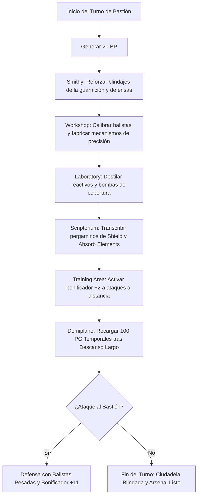

# 🏰 Bastión y Tiempo Muerto — The Fartificer

**Build:** The Fartificer (La Torreta Arcana Blindada)  
**Sistema:** D&D 2024 / 5.5e DMG Bastion Rules  
**Nivel de Bastión:** 20  
**Nombre del Bastión:** *The Iron Foundry & Ballistic Citadel* (La Fundición de Hierro y Ciudadela Balística)  
**Documentos Relacionados:**
* [Guía de Personaje](file:///d:/repo-vault/Proyectos/Rol/DnDbuilds/builds/the%20fartificer/character%20guide.md)
* [Guía 2024](file:///d:/repo-vault/Proyectos/Rol/DnDbuilds/builds/the%20fartificer/character%20guide%202024.md)
* [Lista de Conjuros](file:///d:/repo-vault/Proyectos/Rol/DnDbuilds/builds/the%20fartificer/spell%20list.md)
* [Objetos a Obtener](file:///d:/repo-vault/Proyectos/Rol/DnDbuilds/builds/the%20fartificer/item%20list%20to%20obtain.md)
* [Hoja de Ruta](file:///d:/repo-vault/Proyectos/Rol/DnDbuilds/builds/the%20fartificer/roadmap.md)
* [Inventario Equipado](file:///d:/repo-vault/Proyectos/Rol/DnDbuilds/builds/the%20fartificer/actual%20inventory%20list.md)

---

## 🏛️ Estadísticas Defensivas del Bastión

* **Bonificador de Mando y Defensa:** $\mathbf{+11}$ ($\text{PB } +6 + \text{DEX } +5$).
* **Puntos de Bastión (BP):** 20 BP por Turno de Bastión (regeneración según nivel 20).
* **Guarnición Activa:**
  * 12 Ballesteros Pesados de Vanguardia con armaduras de acero reforzado.
  * 6 Forjadores e Ingenieros de Autómatas.
  * 2 Defensores de Acero Pesados de tamaño Grande emplazados en las puertas de la ciudadela.

---

## 🏗️ Instalaciones Básicas (Basic Facilities)

1. **Dormitorio de la Forja (Bedchambers):** Aposento espartano con planos mecánicos, bancos de trabajo y herramientas colgadas en soportes imantados.
2. **Comedor de los Artilleros (Dining Hall):** Mesas de roble reforzado con platos y jarras de peltre resistentes a impactos.
3. **Pabellón de Armeros (Common Room):** Zona de descanso para los artesanos y artilleros que defienden el perímetro.
4. **Almacén Blindado de Metales (Storage):** Depósito protegido contra incendios con lingotes de hierro, mitril y adamanto.

---

## 🧪 Instalaciones Especiales (Special Facilities: 4 Roomy + 2 Vast)

Conforme a las reglas del DMG 2024 a nivel 20, la fortaleza dispone exactamente de 6 Instalaciones Especiales (4 Roomy y 2 Vast):

### 1. [Roomy] Workshop (Taller Mecánico de Balística)
* **Función:** Diseño y optimización de ballestas repetidoras, disparadores automáticos y proyectiles explosivos.
* **Orden de Bastión:** *Craft*. Fabricación de mecanismos de precisión y componentes para el Defensor de Acero a la mitad del coste estándar.

### 2. [Roomy] Smithy (Gran Herrería Arcana)
* **Función:** Forja de placas de acero endurecido, blindajes para autómatas y escudos antimagia.
* **Orden de Bastión:** *Craft / Reinforce*. Concede un bonificador temporal de $+1$ a la CA de las armaduras de los defensores de la guarnición durante 7 días.

### 3. [Roomy] Laboratory (Laboratorio Alquímico)
* **Función:** Destilación de solventes, pólvora refinada y ácidos para saetas perforadoras.
* **Orden de Bastión:** *Research / Distill*. Elaboración de reactivos químicos y granadas de humo para cobertura táctica.

### 4. [Roomy] Scriptorium (Scriptorium de Planos Arcanos)
* **Función:** Transcripción de diagramas de infusión, esquemas de autómatas y pergaminos de conjuros de Eldritch Knight (*Shield*, *Absorb Elements*).
* **Orden de Bastión:** *Scribe*. Elabora pergaminos de abjuración a coste reducido.

### 5. [Vast] Training Area / Ballista Battery (Batería Balística de Entrenamiento)
* **Función:** Plataforma elevada equipada con 4 balistas pesadas y dianas móviles para adiestramiento militar.
* **Orden de Bastión:** *Train*. Otorga al personaje y a los defensores un bonificador de $+2$ a tiradas de ataque a distancia y $+2$ a la iniciativa durante 7 días.

### 6. [Vast] Demiplane (Cámara Extradimensional de Ensayos)
* **Función:** Espacio dimensional a prueba de explosiones balísticas donde probar armamento experimental sin peligro.
* **Orden de Bastión:** *Sanctuary*. Concede al personaje $100\text{ PG}$ temporales tras completar un descanso largo en su interior.

---

## 🔄 Flujograma de Turno de Bastión (Weekly Bastion Turn)

---

## ⏳ Actividades de Tiempo Muerto (Downtime Priorities)

### Prioridad 1: Mantenimiento y Mejora del Steel Defender
* **Acción:** Emplear herramientas de herrero y hojalatero en el *Workshop* para reparar la coraza y ajustar los servomotores del Defensor de Acero.
* **Resultado:** Restauración total de PG y optimización de su reacción *Deflect Attack*.

### Prioridad 2: Fabricación de Proyectiles y Bombas de Humo
* **Acción:** Sintetizar botes de humo denso en el *Laboratory* (equivalentes al conjuro *Fog Cloud*) para proporcionar cobertura total inmediata en combate abierto.
