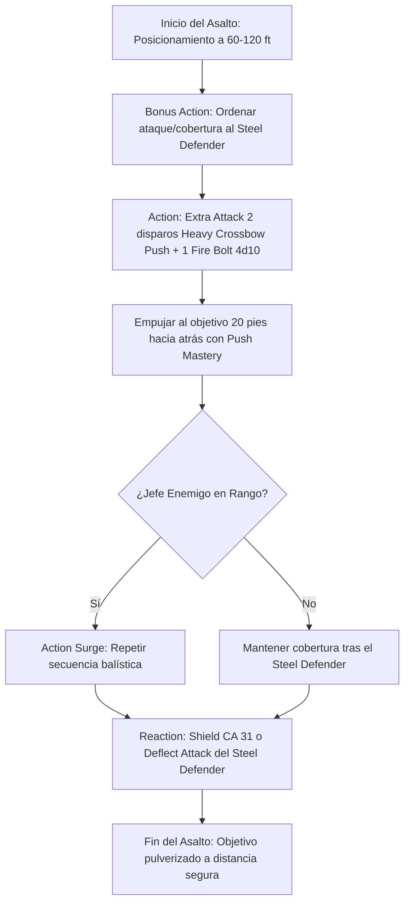

# ⚡ Guía de Personaje — The Fartificer (Edición 2024 / 5.5e)

**Arquetipo:** Heavy Ballistic Turret & Construct Commander  
**Clase:** Fighter (Eldritch Knight) 17 / Artificer (Battle Smith) 3  
**Especie:** Human (Reglas 2024)  
**Trasfondo:** Soldier (Dote de Origen: *Alert* o *Savage Attacker*)  
**Sistema:** D&D 5th Edition (Reglas 2024 / 5.5e)  
**Documentos Relacionados:**
* [Guía Principal](file:///d:/repo-vault/Proyectos/Rol/DnDbuilds/builds/the%20fartificer/character%20guide.md)
* [Bastión y Tiempo Muerto](file:///d:/repo-vault/Proyectos/Rol/DnDbuilds/builds/the%20fartificer/bastion%20and%20downtime.md)
* [Lista de Conjuros](file:///d:/repo-vault/Proyectos/Rol/DnDbuilds/builds/the%20fartificer/spell%20list.md)
* [Objetos a Obtener](file:///d:/repo-vault/Proyectos/Rol/DnDbuilds/builds/the%20fartificer/item%20list%20to%20obtain.md)
* [Hoja de Ruta](file:///d:/repo-vault/Proyectos/Rol/DnDbuilds/builds/the%20fartificer/roadmap.md)
* [Inventario Equipado](file:///d:/repo-vault/Proyectos/Rol/DnDbuilds/builds/the%20fartificer/actual%20inventory%20list.md)

---

## 📊 Atributos y Estadísticas (Nivel 20)

| Atributo | Puntuación | Modificador | Salvación Base | Notas Defensivas |
| :--- | :---: | :---: | :---: | :--- |
| **Fuerza (STR)** | 8 | -1 | +5 (Competente) | Salvación base de Fighter |
| **Destreza (DEX)** | 20 | +5 | +5 | Ataques balísticos, iniciativa y CA |
| **Constitución (CON)** | 16 | +3 | +9 (Competente) | Salvación base de Fighter y concentración |
| **Inteligencia (INT)** | 16 | +3 | +3 | Conjuros EK y Artificer (CD 17) |
| **Sabiduría (WIS)** | 12 | +1 | +1 | Percepción pasiva |
| **Carisma (CHA)** | 8 | -1 | -1 | Atributo de descarte |

* **Puntos de Golpe (PG):** 174 ($17\text{d}10 + 3\text{d}8 + 60 \text{ CON}$).
* **Clase de Armadura (CA):** 26 pasiva (Cuero Tachonado +3, Escudo +3, Defense Fighting Style). CA 31 con reacción (*Shield*).
* **Defensor de Acero (Steel Defender):** CA 15, PG 21, Ataque de Fuerza $+9$ ($1\text{d}8 + 6$). Reacción *Deflect Attack* (Desventaja a 5 pies).

---

## 🏷️ Matriz de Evaluación Táctica

| Categoría | Nivel | Justificación Mecánica |
| :--- | :---: | :--- |
| **Daño Balístico Sostenido** | 🔵 S | 3 ataques pesados por acción a 400 pies. Eldritch Knight 2024 permite sustituir 1 ataque por un cantrip como *Fire Bolt* ($4\text{d}10$) sin gastar Bonus Action. |
| **Burst Damage (Nova)** | 🔵 S | 2 usos de *Action Surge*; desata hasta 6 disparos con *Sharpshooter* ($129$ daño medio) + ataque del Steel Defender en el primer turno. |
| **Supervivencia / EHP** | 🟢 A | CA 26 pasiva (31 con *Shield*), desventaja forzada por *Cloak of Displacement* y *Deflect Attack*, y 2 usos de *Indomitable*. |
| **Control de Campo** | 🟢 A | Maestría *Push* en Heavy Crossbow (empuja 10 pies por impacto = hasta 30 pies por turno fuera de cobertura) y *Slow* en proyectiles. |
| **Economía de Recursos** | 🔵 S | *Repeating Shot* elimina la propiedad de carga y crea munición mágica infinita; *Mending* cura gratis al Steel Defender. |
| **Soporte de Equipo** | 🟡 B | Cobertura táctica del Steel Defender, *Faerie Fire* en área y sanación menor de emergencia. |

---

## 🧮 Motor Matemático (2024 Ruleset)

### 1. Eldritch Knight 2024 War Magic Synergy
En las reglas 2024, el Eldritch Knight puede sustituir uno de sus ataques de *Extra Attack* por un truco con tiempo de lanzamiento de 1 acción:
$$\text{Ataque 1 (Heavy Crossbow)} = 1\text{d}10 + 5 + 1 + 2 + 10 = \mathbf{23.5 \text{ daño}}$$
$$\text{Ataque 2 (Heavy Crossbow)} = 1\text{d}10 + 5 + 1 + 2 + 10 = \mathbf{23.5 \text{ daño}}$$
$$\text{Ataque 3 (Cantrip Fire Bolt)} = 4\text{d}10 = \mathbf{22.0 \text{ daño}}$$
$$\text{DPR Base de Acción} = 23.5 + 23.5 + 22.0 = \mathbf{69.0 \text{ daño bruto por turno}}$$
Sumando el ataque del Defensor de Acero (Bonus Action):
$$\text{Daño Defensor} = 1\text{d}8 + 6 = \mathbf{10.5 \text{ daño de fuerza}}$$
$$\text{DPR Total Sostenido 2024} = 69.0 \times 0.65 + 10.5 \times 0.65 = 44.85 + 6.825 = \mathbf{51.675 \text{ DPR neto}}$$

### 2. Burst Nova con Action Surge (Doble Acción de Ataque)
$$\text{Turno 1 Nova} = [23.5 \times 4] + [4\text{d}10 \times 2] + 10.5 = 94.0 + 44.0 + 10.5 = \mathbf{148.5 \text{ daño bruto}}$$
$$\text{Nova Efectivo} = 148.5 \times 0.65 = \mathbf{96.525 \text{ daño neto a 400 pies}}$$

### 3. Control de Posición con Weapon Mastery: Push
Cada impacto de Ballesta Pesada con la propiedad *Push* empuja a la criatura 10 pies hacia atrás (sin tirada de salvación si impacta):
$$\text{Distancia Total de Empuje en 1 Turno} = 3 \text{ impactos} \times 10\text{ pies} = \mathbf{30 \text{ pies de repulsión}}$$
Permite expulsar a atacantes cuerpo a cuerpo del alcance o empujarlos a abismos y trampas mágicas.

---

## 🔄 Bucle Táctico de Combate (Action Loop)

---

## ⚔️ Integración de Weapon Masteries 2024

* **Heavy Crossbow (Push):** Empuja al objetivo 10 pies hacia atrás en línea recta por cada impacto sin tirada de salvación. Impide que criaturas cuerpo a cuerpo cierren la distancia.
* **Hand Crossbow (Vex):** Si se impacta con la ballesta de mano, concede **Ventaja** en la siguiente tirada de ataque contra ese mismo objetivo, garantizando una precisión devastadora para los siguientes proyectiles de *Sharpshooter*.
