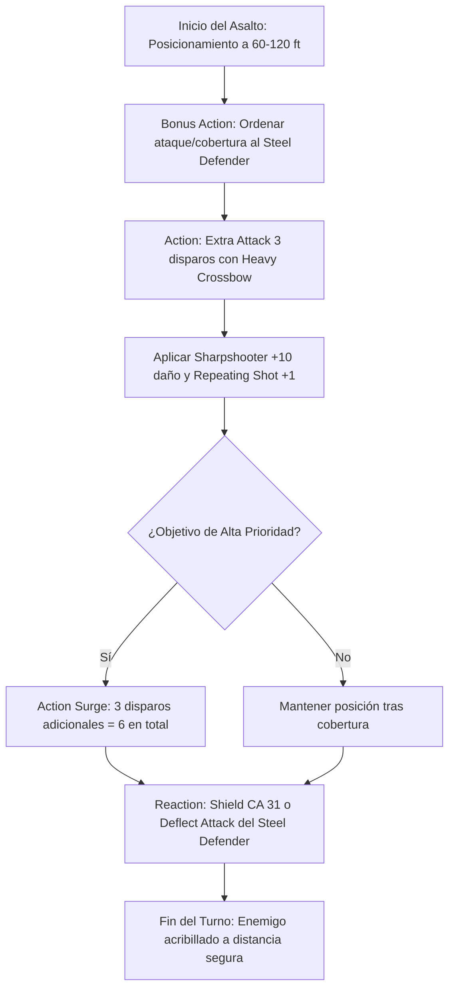

# 🏹 Guía de Personaje — The Fartificer

**Build:** The Fartificer (La Torreta Arcana Blindada)  
**Clase:** Fighter (Eldritch Knight) 17 / Artificer (Battle Smith) 3  
**Especie:** Variant Human  
**Trasfondo:** Soldier / Guild Artisan (Dote de Origen: *Sharpshooter*)  
**Sistema:** D&D 5th Edition (Reglas 2024 / 5.5e & 2014)  
**Rol:** Heavy Crossbow Turret Sniper / Mobile Ballistic Platform / Defensive Construct Warden  
**Documentos Relacionados:**
* [Guía 2024](file:///d:/repo-vault/Proyectos/Rol/DnDbuilds/builds/the%20fartificer/character%20guide%202024.md)
* [Bastión y Tiempo Muerto](file:///d:/repo-vault/Proyectos/Rol/DnDbuilds/builds/the%20fartificer/bastion%20and%20downtime.md)
* [Lista de Conjuros](file:///d:/repo-vault/Proyectos/Rol/DnDbuilds/builds/the%20fartificer/spell%20list.md)
* [Objetos a Obtener](file:///d:/repo-vault/Proyectos/Rol/DnDbuilds/builds/the%20fartificer/item%20list%20to%20obtain.md)
* [Hoja de Ruta](file:///d:/repo-vault/Proyectos/Rol/DnDbuilds/builds/the%20fartificer/roadmap.md)
* [Inventario Equipado](file:///d:/repo-vault/Proyectos/Rol/DnDbuilds/builds/the%20fartificer/actual%20inventory%20list.md)

---

## 📊 Atributos y Estadísticas (Nivel 20)

| Atributo | Puntuación | Modificador | Salvación Base | Notas Defensivas |
| :--- | :---: | :---: | :---: | :--- |
| **Fuerza (STR)** | 8 | -1 | +5 (Competente) | Salvación base de Fighter |
| **Destreza (DEX)** | 20 | +5 | +5 | Ataques con ballesta, iniciativa y CA |
| **Constitución (CON)** | 16 | +3 | +9 (Competente) | Concentración inquebrantable y PG |
| **Inteligencia (INT)** | 16 | +3 | +3 | Lanzamiento de conjuros EK y Artificer |
| **Sabiduría (WIS)** | 12 | +1 | +1 | Percepción y salvaciones mentales |
| **Carisma (CHA)** | 8 | -1 | -1 | Atributo de descarte |

* **Puntos de Golpe (PG):** 174 ($17\text{d}10 + 3\text{d}8 + 60 \text{ CON}$).
* **Clase de Armadura (CA):**
  * Con Ballesta Pesada: $12 + 3 (\text{Studded Leather +3}) + 5 (\text{DEX}) + 1 (\text{Defense}) = \mathbf{21}$.
  * Con Ballesta de Mano + Escudo +3 (*Repeating Shot* anula la necesidad de mano libre): $21 + 5 (\text{Escudo +3}) = \mathbf{26}$.
  * Con Reacción (*Shield*): $\mathbf{31}$.
* **Defensor de Acero (Steel Defender):** CA 15, PG 21, Ataque de Fuerza $+9$ ($1\text{d}8 + 6$), Reacción *Deflect Attack* (desventaja en ataque a 5 pies).

---

## 🏷️ Matriz de Evaluación Táctica

| Categoría | Nivel | Justificación Mecánica |
| :--- | :---: | :--- |
| **Daño Sostenido (DPR)** | 🔵 S | 3 ataques de Ballesta Pesada ($1\text{d}10 + 16$) por turno a 400 pies sin desventaja (*Sharpshooter* + *Repeating Shot*). $64.5$ daño medio constante. |
| **Burst Damage (Nova)** | 🔵 S | 2 usos de *Action Surge* al nivel 17; descarga 6 proyectiles de alto calibre en un asalto ($129$ daño medio) + ataque del Defensor de Acero. |
| **Supervivencia / EHP** | 🟢 A | CA 26 pasiva (31 con *Shield*), *Deflect Attack* imponiendo desventaja en ataques entrantes, *Indomitable* (2/día), y 174 PG base. |
| **Economía de Recursos** | 🔵 S | *Repeating Shot* elimina la propiedad *Loading* y genera munición mágica infinita; no requiere comprar saetas ni recargar. |
| **Control de Campo** | 🟢 A | Disparo a 400 pies sin penalización; *Eldritch Strike* impone desventaja en salvaciones contra tus conjuros al impactar con la ballesta. |
| **Soporte de Grupo** | 🟡 B | *Cure Wounds*, *Faerie Fire* y el Defensor de Acero actuando como muralla de cobertura y absorción de daño para el equipo. |

---

## 🧮 Motor Matemático (2024 / 2014 Ruleset)

### 1. Daño Sostenido por Asalto (Ataque Triple)
Con bono de ataque: $+5 (\text{DEX}) + 6 (\text{PB}) + 2 (\text{Archery}) + 1 (\text{Repeating Shot}) - 5 (\text{Sharpshooter}) = \mathbf{+9}$.
Frente a un enemigo con CA 18 (probabilidad de impacto $P = 0.60$):
$$\text{Daño por Impacto} = 1\text{d}10 (\text{Ballesta Pesada}) + 5 (\text{DEX}) + 1 (\text{Infusión}) + 10 (\text{Sharpshooter}) = 5.5 + 16 = \mathbf{21.5}$$
$$\text{DPR Base} = 3 \times 21.5 \times 0.60 = \mathbf{38.7 \text{ DPR}}$$
Sumando el ataque del Defensor de Acero (Bonus Action):
$$\text{Daño Defensor} = (1\text{d}8 + 6) \times 0.60 = 10.5 \times 0.60 = \mathbf{6.3 \text{ DPR}}$$
$$\text{DPR Total Sostenido} = 38.7 + 6.3 = \mathbf{45.0 \text{ DPR}}$$

### 2. Burst Damage Nova (Action Surge — 6 Disparos)
$$\text{Nova Turno 1} = 6 \times 21.5 \times 0.60 + 6.3 = 77.4 + 6.3 = \mathbf{83.7 \text{ daño efectivo}}$$
*(Si todos los impactos aciertan: $6 \times 21.5 + 10.5 = \mathbf{139.5 \text{ daño bruto}}$).*

### 3. Supervivencia Efectiva (EHP)
Con configuración de Ballesta de Mano + Escudo +3 (CA 26 pasiva):
Frente a un monstruo de CR 20 con $+14$ al ataque:
Probabilidad de impacto ordinaria: $P = \frac{21 - (26 - 14)}{20} = 0.45 \quad (45\%)$.
Con *Deflect Attack* del Defensor de Acero imponiendo Desventaja en el primer ataque:
$$P_{\text{desv}} = (0.45)^2 \approx 0.2025 \quad (20.25\%)$$
Con reacción de *Shield* activa (CA 31, impacto solo con 17-20, $P = 0.20$):
$$\text{EHP Pasivo} = \frac{174 + 100 (\text{Demiplane THP})}{0.45 \times 0.70} \approx \mathbf{869.8 \text{ EHP}}$$
$$\text{EHP con Shield} = \frac{274}{0.20} = \mathbf{1{,}370.0 \text{ EHP}}$$

---

## 🔄 Bucle Táctico de Combate (Action Loop)

### Turno 0 (Preparación)
* Verificar la infusión de *Repeating Shot* en la ballesta.
* Desplegar al Defensor de Acero en vanguardia o adyacente para cobertura de +2 CA (Half Cover).
* Concentración en *Haste* (+2 CA, +1 ataque por turno) o *Faerie Fire* para ventaja grupal.

### Turno 1 (Bombardeo Balístico)
1. **Bonus Action:** Ordenar al Defensor de Acero trabar combate con el atacante cuerpo a cuerpo más cercano.
2. **Action:** 3 disparos pesados con *Sharpshooter* a máxima distancia ($400\text{ pies}$ sin desventaja).
3. **Action Surge (si se requiere aniquilación rápida):** 3 disparos adicionales sobre el mismo blanco.

### Turnos Subsiguientes
* Mantener cadencia de fuego a distancia.
* **Reaction:** Activar *Shield* (+5 CA) ante ataques a distancia, mientras el Defensor de Acero usa *Deflect Attack* para desviar cualquier ataque cuerpo a cuerpo entrante.
