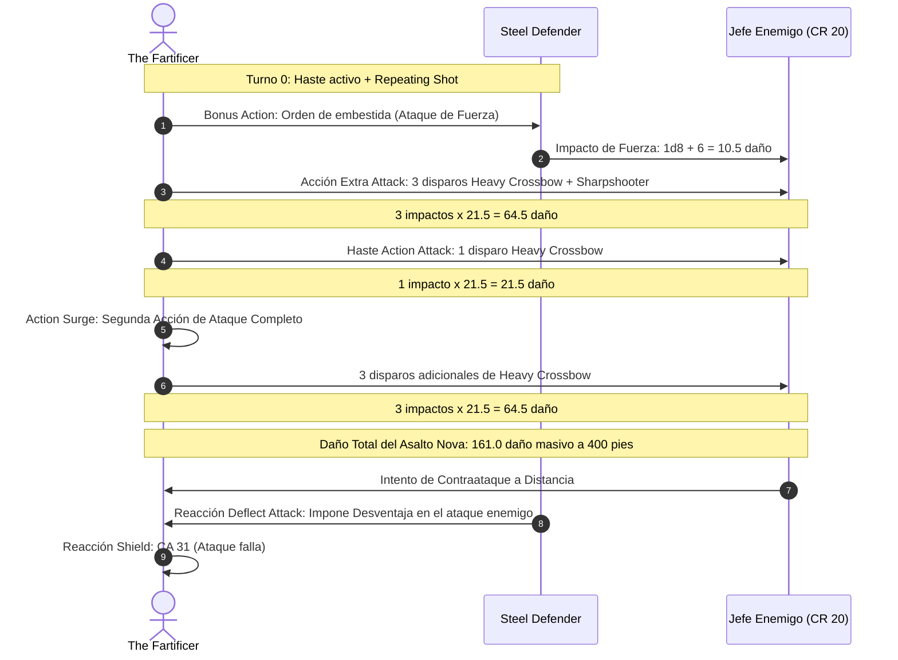

# 📜 Lista de Conjuros e Infusiones — The Fartificer

**Build:** The Fartificer (La Torreta Arcana Blindada)  
**Clase:** Fighter (Eldritch Knight) 17 / Artificer (Battle Smith) 3  
**Nivel de Lanzador Combinado:** Nivel 7 de Ranuras (Eldritch Knight 17 / 3 = 5 + Artificer 3 / 2 = 2)  
**Ranuras Disponibles:** 4 de Nivel 1, 3 de Nivel 2, 3 de Nivel 3, 1 de Nivel 4  
**CD de Conjuros:** $8 + 6 (\text{PB}) + 3 (\text{INT}) = \mathbf{17}$  
**Documentos Relacionados:**
* [Guía de Personaje](file:///d:/repo-vault/Proyectos/Rol/DnDbuilds/builds/the%20fartificer/character%20guide.md)
* [Guía 2024](file:///d:/repo-vault/Proyectos/Rol/DnDbuilds/builds/the%20fartificer/character%20guide%202024.md)
* [Bastión y Tiempo Muerto](file:///d:/repo-vault/Proyectos/Rol/DnDbuilds/builds/the%20fartificer/bastion%20and%20downtime.md)
* [Objetos a Obtener](file:///d:/repo-vault/Proyectos/Rol/DnDbuilds/builds/the%20fartificer/item%20list%20to%20obtain.md)
* [Hoja de Ruta](file:///d:/repo-vault/Proyectos/Rol/DnDbuilds/builds/the%20fartificer/roadmap.md)
* [Inventario Equipado](file:///d:/repo-vault/Proyectos/Rol/DnDbuilds/builds/the%20fartificer/actual%20inventory%20list.md)

---

## ⚡ Efectos Activos y Buffs Previos (Turn 0)

| Efecto / Habilidad | Duración | Concentración | Beneficio Mecánico |
| :--- | :---: | :---: | :--- |
| **Repeating Shot (Infusión)** | Permanente | No | Elimina la propiedad *Loading*, genera munición infinita, concede $+1$ a ataque y daño. |
| **Steel Defender** | Permanente | No | Constructo activo: impone Desventaja en ataques enemigos a 5 pies (*Deflect Attack*). |
| **Aid (Ranura Nivel 4)** | 8 horas | No | $+15\text{ PG}$ máximos y actuales al Fartificer, al Defensor de Acero y a un aliado. |
| **Mage Armor / Studded Leather +3** | Permanente | No | CA base 20 (o 26 con escudo). |
| **Haste** | 1 minuto | Sí | $+2$ a la CA, doble velocidad y 1 ataque adicional por asalto. |

---

## 📊 Matriz de Conjuros Preparados y Conocidos

### Trucos (Cantrips)
* **Fire Bolt (Eldritch Knight):** 🟢 A. Ataque a distancia elemental si la ballesta no está al alcance.
* **Mending (Artificer):** 🔵 S. **Esencial**. Cura $2\text{d}6$ PG al Defensor de Acero fuera de combate sin coste de recursos.
* **Guidance (Artificer):** 🔵 S. $+1\text{d}4$ a cualquier prueba de habilidad o iniciativa.
* **Booming Blade (Eldritch Knight):** 🟡 B. Opción de castigo si un enemigo logra trabar combate cuerpo a cuerpo.

### Nivel 1
* **Shield (Eldritch Knight):** 🔵 S. Reacción fundamental. Eleva la CA a 31 temporalmente, anulando ráfagas enemigas.
* **Absorb Elements (Eldritch Knight / Artificer):** 🔵 S. Reduce el daño elemental recibido a la mitad y añade daño al siguiente impacto.
* **Cure Wounds (Artificer):** 🟢 A. Sanación de emergencia para revivir aliados o restaurar al Defensor de Acero.
* **Faerie Fire (Artificer):** 🔵 S. Concede **Ventaja** a todos los ataques con ballesta contra los objetivos en un cubo de 20 pies.
* **Heroism (Battle Smith Domain):** 🟡 B. Inmunidad a miedo y PG temporales por asalto.

### Nivel 2
* **Misty Step (Eldritch Knight):** 🔵 S. Teletransporte de 30 pies con Bonus Action para salir de situaciones de encajonamiento.
* **Web (Eldritch Knight / Artificer):** 🟢 A. Bloqueo de avance enemigo para disparar a placer desde la distancia.
* **Warding Bond (Battle Smith Domain):** 🟢 A. Transfiere la mitad del daño recibido a un clon o al Defensor de Acero.
* **Darkness (Eldritch Knight):** 🟡 B. Cobertura visual contra magos enemigos.

### Nivel 3 y 4
* **Haste (Eldritch Knight):** 🔵 S. Eleva la cadencia de fuego a 4 ataques por turno (o 7 con Action Surge) y otorga +2 CA.
* **Counterspell (Eldritch Knight):** 🔵 S. Neutraliza conjuros enemigos que amenacen la posición de la torreta.
* **Fireball (Eldritch Knight):** 🟢 A. Limpieza de hordas enemigas ($8\text{d}6$ de fuego) antes de iniciar los disparos de precisión.
* **Dimension Door (Ranura Nivel 4):** 🟢 A. Reubicación instantánea de la torreta y su constructo a 500 pies.

---

## 🔄 Diagrama de Secuencia: Nova Ballistic Barrage (Action Surge)

---

## 💖 Curación en Segundo Plano (Background Healing)

1. **Repair del Steel Defender:** El Defensor de Acero puede usar su acción para restaurar $2\text{d}8 + 2$ PG a sí mismo o a otro constructo 3 veces al día.
2. **Mending Infinito:** Fuera de combate, el truco *Mending* restaura $2\text{d}6$ PG por lanzamiento al Defensor de Acero sin gastar un solo espacio de conjuro ni recurso diario.
3. **Second Wind (Guerrero):** Regenera $1\text{d}10 + 17 = \mathbf{22.5 \text{ PG}}$ con Bonus Action una vez por descanso corto (o múltiples usos en 2024).
4. **Cure Wounds con Ranuras Bajas:** 4 ranuras de nivel 1 dedicadas a estabilizar al grupo o levantar aliados inconscientes.
