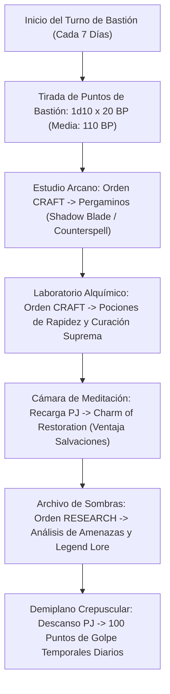

# 🏰 Bastión y Tiempo Muerto — The Shadow Mage

## 🏰 Sistema de Bastiones (Reglas Oficiales 2024 / 5.5e DMG)

*Estructura de gestión de la base de operaciones, automatización de turnos de bastión y mecánicas de mando del personaje a Nivel 20.*

* **Nombre del Bastión:** La Torre del Crepúsculo Velado (The Veiled Twilight Spire)
* **Nivel de Bastión (Bastion Level):** 20 (Nivel Máximo)
* **Puntos de Bastión (Bastion Points - BP):** 520 BP acumulados
* **Puntuación de Mando (Bastion Defender Stats):** 
  * STR 8 (-1) | DEX 20 (+5) | CON 14 (+2) | **INT 20 (+5 / +6 con Tomo)** | WIS 13 (+1) | CHA 8 (-1)
  * Modificador de Mando Primario: **+5/+6 (Inteligencia) + 6 (PB) = +11 / +12**

---

### Instalaciones Básicas (Basic Facilities — Oficiales DMG 2024)

*Instalaciones comunes sin coste de ranura especial según la DMG 2024:*

1. **Dormitorio Principal (Bedchambers):** Aposentos personales en la cúspide de la aguja de obsidiana, envueltos en un microclima perpetuo de penumbra mágica y seda élfica.
2. **Comedor (Dining Hall):** Salón comunal de basalto pulido donde magos del Canto de Hoja, clérigos del crepúsculo y espías arcanos planifican operaciones.
3. **Espacio Común (Common Room):** Ágora cartográfica con cartas de tránsito planar, relojes de arena de sombras y atriles de lectura en luz tenue.
4. **Cocina y Almacén General (Kitchen & Storage):** Infraestructura de reserva para abastecer a la guarnición élfica durante 6 meses de asedio continuo.

---

### Instalaciones Especiales Optimizadas (6 Especiales RAW: 4 Roomy + 2 Vast)

*El sistema oficial otorga exactamente **6 Instalaciones Especiales** a Nivel 20 (4 Espaciosas + 2 Extensas). Su configuración ha sido min-maxeada para abastecer consumibles tácticos, potenciar el EHP pasivo y suministrar ventajas arcanas únicas:*

* **1. Estudio Arcano (Arcane Study) — [Oficial DMG 2024 — Nivel 5] [Espaciosa / Roomy]:**
  * *Estado:* Activa (Orden: **Craft**)
  * *Prerrequisito Oficial:* Rasgo *Spellcasting*.
  * *Personal Asignado:* 1 Investigador Arcano y Escriba de Sombras.
  * *Beneficio Pasivo Oficial:* Concede un **Charm de Identificar** tras cada Descanso Largo en el bastión (lanzamiento gratuito de *Identify* sin consumir ranura ni componentes).
  * *Orden de Bastión Oficial:* **Craft (Pergaminos Mágicos y Focos Arcanos).**
  * *Sinergia con el Build:* 🔵 **Indispensable**. Permite fabricar pergaminos de combate (*Shadow Blade*, *Counterspell*, *Silvery Barbs*, *Wall of Force*) para economizar ranuras diarias y calibrar estoques arcanos.

* **2. Laboratorio Alquímico (Laboratory) — [Oficial DMG 2024 — Nivel 5/9] [Espaciosa / Roomy]:**
  * *Estado:* Activa (Orden: **Craft**)
  * *Prerrequisito Oficial:* Ninguno.
  * *Personal Asignado:* 1 Maestro Alquimista y Destilador de Penumbra.
  * *Orden de Bastión Oficial:* **Craft (Pociones Tácticas y Elixires).**
  * *Sinergia con el Build:* 🔵 **Roto/Indispensable**. Genera consumibles de combate vitales:
    1. **Pociones de Rapidez (*Potion of Speed*):** Otorga los beneficios de *Haste* durante 1 minuto **sin requerir concentración**, concediendo un ataque adicional por turno, +2 a la CA y velocidad duplicada sin interferir con la concentración en *Shadow Blade*.
    2. **Pociones de Curación Suprema ($10\text{d}4 + 20$ HP):** En las reglas 2024 (5.5e), beber una poción propia es una **Acción Adicional**, permitiendo restaurar salud sin perder los ataques con *Shadow Blade*.

* **3. Círculo de Teletransporte (Teleportation Circle) — [Oficial DMG 2024 — Nivel 9] [Espaciosa / Roomy]:**
  * *Estado:* Activa (Orden: **Maintain**)
  * *Prerrequisito Oficial:* Rasgo *Spellcasting*.
  * *Personal Asignado:* 1 Guardián del Vórtice Rúnico.
  * *Orden de Bastión Oficial:* **Maintain (Enlace de Tránsito Planar).**
  * *Sinergia con el Build:* 🔵 **Indispensable**. Alberga un círculo permanente de sigilos grabado en plata y obsidiana. Conecta la torre con la red de transporte del Plano de la Sombra y los círculos mayores del plano material.

* **4. Archivo de Sombras (Archive) — [Oficial DMG 2024 — Nivel 13] [Extensa / Vast]:**
  * *Estado:* Activa (Orden: **Research**)
  * *Prerrequisito Oficial:* Ninguno.
  * *Personal Asignado:* Eruditos e Investigadores Arcanos.
  * *Beneficio Pasivo Oficial:* Los operarios investigan durante 7 días para otorgar los efectos del conjuro ***Legend Lore* (5.º nivel)** sin consumir ranuras ni los 450 po de coste material.
  * *Sinergia con el Build:* 🟢 **Excelente**. Permite desentrañar la historia de artefactos y debilidades de enemigos sin gastar recursos de combate.

* **5. Cámara de Meditación (Meditation Chamber) — [Oficial DMG 2024 — Nivel 13] [Extensa / Vast]:**
  * *Estado:* Activa (Orden: **Empower**)
  * *Prerrequisito Oficial:* Ninguno.
  * *Personal Asignado:* 1 Maestro Contemplativo del Trance Élfico.
  * *Beneficio Pasivo Oficial:* Concede el **Talismán de Restauración (*Charm of Restoration*)**, que otorga **Ventaja en tiradas de salvación de Inteligencia, Destreza o Constitución** durante 7 días.
  * *Sinergia con el Build:* 🔵 **Roto**. Sumado al bono de $+5$ de *Bladesong* y *War Caster*, superar cualquier salvación de concentración es matemáticamente absoluto.

* **6. Demiplano del Santuario Crepuscular (Sanctum / Demiplane) — [Oficial DMG 2024 — Nivel 17] [Extensa / Vast]:**
  * *Estado:* Activa (Orden: **Maintain**)
  * *Prerrequisito Oficial:* Lanzador de Conjuros de Nivel 17+.
  * *Personal Asignado:* 1 Guardián del Umbral Dimensional.
  * *Beneficio Pasivo Oficial:* Concede **100 Puntos de Golpe Temporales** diarios tras realizar un Descanso Largo en su interior e inmunidad frente a sensores mágicos y escudriñamiento (*Scrying*).
  * *Sinergia con el Build:* 🔵 **EHP Colosal y Santuario del Simulacro**. Suministra un colchón pasivo de 100 Temp HP que amortigua cualquier impacto fortuito y alberga al *Simulacrum* gemelo del Bladesinger.

---

## ⚡ Protocolo de Automatización del Turno de Bastión (Weekly Routine)

### 1. Tabla de Producción Semanal de Consumibles Tácticos

| Instalación | Orden Asignada | Producto Semanal Obtenido | Utilidad Táctica META |
| :--- | :---: | :--- | :--- |
| **Estudio Arcano** | Craft | 1x Pergamino de 3.er o 4.º Nivel (*Shadow Blade* / *Wall of Force*) | Ranuras de combate ahorradas; despliegue inmediato. |
| **Laboratorio** | Craft | 1x *Potion of Speed* o *Supreme Healing* | Beneficios de *Haste* sin concentración o curación de $10\text{d}4 + 20$ en Acción Adicional. |
| **Cámara Meditación**| Empower | 1x *Charm of Restoration* | Ventaja en tiradas de salvación de concentración y físicas durante 7 días. |
| **Archivo Sombras** | Research | Información Táctica / *Legend Lore* | Análisis de debilidades de jefes sin coste de ranuras ni componentes. |
| **Demiplano** | Descanso PJ | **100 Temp HP Diarios** | Depósito masivo de vida temporal para vanguardia. |

---

## 🛡️ Mecánicas de Defensa, Guarnición y Resolución de Asedios

### 1. Estadísticas de Defensa del Bastión
* **Puntuación de Mando (Defender Rating):**
  $$\text{Modificador de Mando} = \text{Bono de Competencia (+6)} + \text{Modificador de Inteligencia (+5)} = \mathbf{+11}$$
* **Guarnición Activa Permanente:**
  * **16 Espadachines Élficos del Crepúsculo:** Guerreros de vanguardia diestros en el estoque y arcos largos, blindados con armaduras tachonadas de sombras.
  * **Aura de Penumbra Eterna:** Toda la fortaleza está bañada en Luz Tenue permanente generada por los prismas de cuarzo crepuscular del vértice de la torre.
  * **Invocaciones de Sombras (*Summon Shadow Spawn*):** Centinelas incorpóreos que patrullan los muros con sigilo $+10$ y resistencia al daño no mágico.

### 2. Red de Protección Arcana Permanente (Abjuration Wards)
1. **Santuario Privado Permanente (*Mordenkainen's Private Sanctum*):**
   * Impide la adivinación, sensores mágicos y bloquea el teletransporte hostil no autorizado directo a la torre.
2. **Red de Glifos de Custodia (*Glyphs of Warding*):**
   * Grabados en el Círculo de Teletransporte para activar *Dispel Magic (Nivel 7)* y *Synaptic Static* contra cualquier intruso que no porte el anillo con el sello de la torre.

---

## ⏳ Actividades de Tiempo Muerto (Downtime Activities)

### Prioridad 1: Mantenimiento y Sincronización del Simulacro Gemelo (Simulacrum)
* **Mecánica:** Conjuro de 7.º nivel de Mago (1,500 po en polvo de rubí).
* **Ubicación:** Demiplano del Santuario Crepuscular.
* **Resultado:** Un duplicado idéntico del Bladesinger con su propia reserva de ranuras de nivel 1 a 9, *Bladesong* y *Twilight Sanctuary*, permitiendo duplicar el daño de *Shadow Blade* o sostener un doble campo de luz tenue en batallas de asedio.

### Prioridad 2: Transcripción Arcana y Destilación de Elixires
* **Mecánica:** Kit de Calígrafo (+11) y Suministros de Alquimista (+11).
* **Objetivo:** Acumular un suministro constante de Pociones de Rapidez (para velocidad extrema sin concentración) y pergaminos de alta abjuración.

---

## 🏃‍♂️ Modos de Movimiento, Logística y Despliegue

* **Caminar (Walk):** 30 pies base / **40 pies durante *Bladesong*** (+10 ft nativo de la clase).
* **Trepar (Climb):** 20 pies (Ventaja con acrobacias de Bladesong).
* **Volar (Fly):** 60 pies (vía *Fly* o *Staff of the Magi*).
* **Teletransporte a Voluntad:** 30 pies en Acción Adicional sin consumir ranuras (*Misty Step* vía *Spell Mastery*).
* **Visión en la Oscuridad:** **300 pies** (*Eyes of Night* de Clérigo del Crepúsculo, compartible con aliados).
* **Percepción Pasiva:** 11 base / 16 con Ventaja (*Sentinel Shield*).
