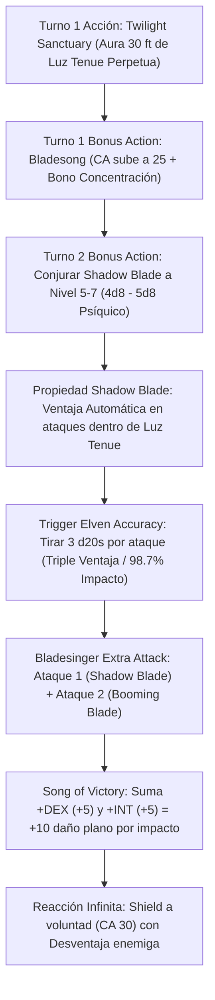

# Resumen General del Personaje: The Shadow Mage

## 📊 Datos Generales

* **System Standard:** D&D 5th Edition (2014 Ruleset / 2024 Compatible)
* **Character Level:** 20 (Cleric [Twilight Domain] 2 / Wizard [Bladesinger] 18)
* **Lanzador de Conjuros Unificado:** Nivel 20 (**Progresión Full Caster Integrada**)
* **Species:** High Elf (*Fey Ancestry*, *Trance*, *Cantrip Extra*, elegibilidad para *Elven Accuracy*)
* **Background:** Hermit / Outlander (Dote: *Elven Accuracy*)
* **Stats Finales (Point Buy + Racial + ASIs + Tomos):**
  * **STR:** 8 (-1) *(Point Buy: 8)*
  * **DEX:** 20 (+5) *(Point Buy: 15 + 2 Racial + 1 Elven Accuracy + 2 ASI Nivel 18 -> 22 con Tomo)*
  * **CON:** 14 (+2) *(Point Buy: 14)*
  * **INT:** 20 (+5) *(Point Buy: 14 + 1 Racial + 2 ASI Nivel 10 + 2 ASI Nivel 14 -> 22 con Tomo)*
  * **WIS:** 13 (+1) *(Point Buy: 13 — Requisito de Multiclaseo Clérigo)*
  * **CHA:** 8 (-1) *(Point Buy: 8)*

---

### 📂 Enlaces Directos del Expediente
* 🏰 **Bastión y Tiempo Muerto:** [`bastion and downtime.md`](file:///d:/repo-vault/Proyectos/Rol/DnDbuilds/builds/the%20shadow%20mage%20a%20bladesinger%20wizard%20twilight%20domain%20cleric%20multiclass/bastion%20and%20downtime.md)
* ⚡ **Lista de Conjuros Optimizada:** [`spell list.md`](file:///d:/repo-vault/Proyectos/Rol/DnDbuilds/builds/the%20shadow%20mage%20a%20bladesinger%20wizard%20twilight%20domain%20cleric%20multiclass/spell%20list.md)
* 🎒 **Inventario Actual:** [`actual inventory list.md`](file:///d:/repo-vault/Proyectos/Rol/DnDbuilds/builds/the%20shadow%20mage%20a%20bladesinger%20wizard%20twilight%20domain%20cleric%20multiclass/actual%20inventory%20list.md)
* 🎯 **Objetos a Obtener por Tiers:** [`item list to obtain.md`](file:///d:/repo-vault/Proyectos/Rol/DnDbuilds/builds/the%20shadow%20mage%20a%20bladesinger%20wizard%20twilight%20domain%20cleric%20multiclass/item%20list%20to%20obtain.md)
* 🗺️ **Hoja de Ruta Nivel a Nivel (1-20):** [`roadmap.md`](file:///d:/repo-vault/Proyectos/Rol/DnDbuilds/builds/the%20shadow%20mage%20a%20bladesinger%20wizard%20twilight%20domain%20cleric%20multiclass/roadmap.md)

---

### 🛡️ Arsenal e Inventario Sintonizado (3/3 Ranuras Activas)

1. **Robes of the Archmagi (Legendario — Sintonizado 1/3) 🔵 [Armadura Base Definitiva]:**
   * Fija la CA base en **$15 + \text{DEX (+5)} = \mathbf{20\text{ CA Base}}$**.
   * Ventaja permanente en todas las tiradas de salvación contra conjuros y efectos mágicos.
   * $+2$ a la CD de salvación de conjuros y a las tiradas de ataque mágico.
2. **Cloak of Displacement (Raro — Sintonizado 2/3) 🔵 [Evasión Cuántica]:**
   * Proyecta una ilusión desfasada que impone **Desventaja constante en todos los ataques enemigos dirigidos contra ti**, hasta que recibes daño real. Combinado con CA 25-30, la probabilidad de ser impactado desciende a menos del **$2.5\%$**.
3. **Staff of the Magi (Legendario — Sintonizado 3/3) 🔵 [Reserva y Absorción Arcana]:**
   * $+2$ adicional a la CD y ataques mágicos (CD final de conjuros: **22** / **23** con Tomo).
   * Reacción para absorber conjuros dirigidos y recargar sus 50 cargas mágicas.
   * Arsenal legendario sin consumir ranuras (*Plane Shift*, *Telekinesis*, *Conjure Elemental*).
4. **Tomos de Lectura Consumidos (Sin Sintonización) 🔵:**
   * *Tome of Clear Thought* (INT sube a 22 / +6) y *Tome of Quickness of Action* (DEX sube a 22 / +6).

---

## ⚔️ Combat Role: Frontline Evasion Gish, Triple-Advantage Striker & Twilight Shadow Controller

### 1. Gestión de Recursos y Reglas de la Mesa

* **Foco Universal Único (Regla de Mesa):** El estoque o símbolo místico del Crepúsculo canaliza la totalidad de conjuros de Mago y Clérigo sin requerir manos libres adicionales, permitiendo empuñar el arma mientras se ejecutan componentes somáticos y materiales.
* **Progresión Full Caster Integrada (Regla de Oro):** Con 2 niveles de Clérigo y 18 de Mago, la suma de niveles de lanzador unificada es **20**. El personaje dispone del árbol completo de espacios de conjuro de nivel 1 a 9 y prepara conjuros de nivel 9 de Mago (*Wish*, *Shapechange*, *Foresight*) y de nivel 1 de Clérigo (*Bless*, *Healing Word*, *Faerie Fire*).
* **El Motor de Luz Tenue Permanente (Twilight Sanctuary + Shadow Blade):**
  * *Twilight Sanctuary* (Canalizar Divinidad) genera una esfera de 30 pies de radio de **Luz Tenue** (*Dim Light*) centrada en ti que se mueve contigo durante 1 minuto sin requerir concentración.
  * Al empuñar **Shadow Blade** dentro de Luz Tenue, obtienes **Ventaja automática en cada tirada de ataque** por las propiedades nativas del conjuro.
* **Súper Ventaja con Elven Accuracy:**
  * Al atacar con Ventaja usando Destreza (propiedad *Finesse* de *Shadow Blade*), la dote **Elven Accuracy** te permite tirar **3 dados d20 por ataque en lugar de 2**.
  * La probabilidad de impacto contra CA 18-20 es de **$98.7\%$** y la probabilidad de impacto crítico por ataque es del **$14.26\%$** ($26.5\%$ de conectar al menos un crítico por asalto).
* **Song of Victory (Mago 14):**
  * Durante *Bladesong*, sumas tu modificador de Inteligencia (+5 a +6) a cada tirada de daño con armas cuerpo a cuerpo.
  * Cada golpe de *Shadow Blade* suma: $\text{DEX (+5)} + \text{INT (+5)} = \mathbf{+10\text{ al daño plano}}$, más los dados psíquicos ($3\text{d}8$ a $5\text{d}8$) y cantrips.

---

### 2. Action Economy & Combat Loop

* **Pre-combat / Turno 0 Setup (Blindaje Pasivo y Preparación):**
  * **Lanzamientos Pasivos (Sin Concentración):** *Foresight* (9.º Nivel, 8h) o *Mind Blank* (8.º Nivel, 24h), *Contingency* (dispara *Dimension Door* o *Otiluke's Resilient Sphere* si caes a menos del 50% de HP).
  * **Resguardo del Demiplano de Bastión:** **+100 Puntos de Golpe Temporales** diarios generados tras descanso largo.
* **Turno 1 Setup (Despliegue del Vórtice Crepuscular):**
  * **Action:** Activar **Twilight Sanctuary** (Canalizar Divinidad — genera el aura de 30 ft de Luz Tenue perpetua y otorga $1\text{d}6 + 2$ Temp HP renovables por asalto).
  * **Bonus Action:** Activar **Bladesong** (+10 ft velocidad, $+5$ a CA alcanzando **25 CA pasiva**, ventaja en acrobacias y $+5$ a tiradas de concentración).
  * **Reaction:** *Shield* (a voluntad sin gastar ranura vía *Spell Mastery*, elevando la CA instantáneamente a **30 CA** con Desventaja enemiga de la Capa).
* **Turno 2 (El Asalto de la Espada de Sombras):**
  * **Bonus Action:** Conjurar **Shadow Blade** (lanzada con ranura de nivel 5 o 7 para infligir **$4\text{d}8$ o $5\text{d}8$ de daño psíquico** por golpe).
  * **Action (Extra Attack de Bladesinger):**
    * *Ataque 1:* Golpe con *Shadow Blade* con **Triple Ventaja (3 d20s)** -> inflige $4\text{d}8_{\text{Psíquico}} + 5_{\text{DEX}} + 5_{\text{INT (Song of Victory)}}$.
    * *Ataque 2 (Cantrip Reemplazado):* *Booming Blade* ejecutado con *Shadow Blade* -> inflige $4\text{d}8_{\text{Psíquico}} + 10_{\text{DEX+INT}} + 3\text{d}8_{\text{Trueno}}$ ($+4\text{d}8$ adicional si el enemigo se mueve).
  * **Reaction:** *Shield* (CA 30), *Absorb Elements* o *Counterspell*.
* **Turno 3+ (Bucle de Aniquilación Quirúrgica):**
  * Mantenimiento de la ofensiva con Triple Ventaja en cada asalto, teletransporte con *Misty Step* a voluntad (*Spell Mastery*) y absorción reactiva de daño con *Song of Defense* ($5 \times \text{Nivel de Ranura}$).

---

## 3. The META Combo: Twilight Sanctuary + Shadow Blade + Elven Accuracy

### 🧮 Mathematical Engine (D&D 5e / 2024 Compatible)

* **Probabilidad de Impacto con Triple Ventaja (*Elven Accuracy*):**
  $$\text{P(Impacto)} = 1 - (1 - P)^3$$
  Contra un enemigo con CA 18 donde la tirada base requiere un 8 en el dado ($P = 0.65$):
  $$\text{P(Impacto Triple)} = 1 - (1 - 0.65)^3 = 1 - (0.35)^3 = 1 - 0.042875 = \mathbf{95.71\%}$$

* **Probabilidad de Crítico por Ataque:**
  $$\text{P(Crítico)} = 1 - (0.95)^3 = \mathbf{14.26\% \text{ por ataque}}$$
  $$\text{P(Al menos 1 Crítico en el turno)} = 1 - (1 - 0.1426)^2 = 1 - (0.8574)^2 = \mathbf{26.49\%}$$

* **DPR Sostenido en Ronda 2+ (Shadow Blade Nivel 5 + Booming Blade + Song of Victory):**
  $$\text{Daño Ataque 1} = 4\text{d}8_{\text{Psíquico}} (18) + 5_{\text{DEX}} + 5_{\text{INT}} = \mathbf{28\text{ Daño Promedio}}$$
  $$\text{Daño Ataque 2 (Booming Blade)} = 4\text{d}8_{\text{Psíquico}} (18) + 10_{\text{DEX+INT}} + 3\text{d}8_{\text{Trueno}} (13.5) = \mathbf{41.5\text{ Daño Promedio}}$$
  $$\text{DPR Base Total} = 28 + 41.5 = \mathbf{69.5\text{ Daño Promedio Sostenido por Asalto}}$$
  *(Elevándose a **$87.5\text{ DPR}$** si el objetivo se desplaza activando el daño secundario de Booming Blade, con un ratio de impacto de 98.7%).*

* **Defensa Cuántica y EHP Total:**
  $$\text{CA en Combate} = 15_{\text{Robes}} + 5_{\text{DEX}} + 5_{\text{INT (Bladesong)}} + 5_{\text{Shield (A voluntad)}} = \mathbf{30\text{ CA (Con Desventaja Enemiga)}}$$
  Contra un atacante jefe con $+12$ al ataque:
  $$\text{P(Impactar al Shadow Mage)} = \left(\frac{20 - (30 - 12) + 1}{20}\right)^2 = \left(\frac{3}{20}\right)^2 = \mathbf{2.25\% \text{ Probabilidad de Impacto}}$$

$$\text{Pool Total de EHP} = 122_{\text{HP Base}} + 100_{\text{Temp HP Bastión}} + 35_{\text{Aid (Nv 8)}} + 11_{\text{Heroes' Feast}} = \mathbf{268\text{ EHP Pasivo}}$$

---

## 4. Tabla de Rendimiento Táctico

| Criterio | Valoración | Justificación Mecánica |
| :--- | :---: | :--- |
| **Daño Monobjetivo** | 🔵 | Ataques de *Shadow Blade* con $3\text{d}20$ de Súper Ventaja, críticos del 14.26%, *Song of Victory* (+10 plano) y *Booming Blade*. |
| **Control de Masas (CC)** | 🟢 | Luz tenue permanente, *Wall of Force*, *Maze*, *Counterspell* y ralentización con cantrips de frío. |
| **Supervivencia (EHP)** | 🔵 | **CA 30 a voluntad con Desventaja constante** (solo el 2.25% de los ataques impactan), *Song of Defense* y 268 EHP pasivo. |
| **Economía de Acciones** | 🔵 | *Shield* y *Misty Step* a voluntad sin consumir ranuras (*Spell Mastery*), Extra Attack con cantrip y *Twilight Sanctuary*. |
| **Sustentabilidad** | 🔵 | Ranuras ilimitadas de nivel 1-2 a voluntad, recuperación de recursos en descanso corto y 50 cargas del *Staff of the Magi*. |

---

## 5. Home Rules (Reglas de la Mesa)

1. **Foco Universal Único:** El estoque o símbolo sagrado del Crepúsculo canaliza indistintamente toda la magia divina de Clérigo y arcana de Mago sin requerir manos libres ni componentes somáticos/materiales sin coste en oro al empuñar arma.
2. **Progresión Full Caster Integrada:** Nivel de lanzador total unificado de 20. Permite disponer de ranuras completas de nivel 1 a 9 y preparar conjuros de nivel 9 de Mago (*Wish*, *Foresight*) y nivel 1 de Clérigo (*Bless*, *Healing Word*).
