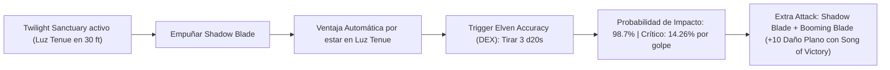

# 🌟 Lista de Conjuros Optimizada — The Shadow Mage (Nivel 20)

Esta lista sigue estrictamente las reglas oficiales de **D&D 5e (2024 / 5.5e Compatible)** integradas con las reglas de mesa de **Progresión Full Caster Integrada** y el **Foco Universal Único**.

A Nivel 20 (Clérigo [Crepúsculo] 2 / Mago [Canto de Hoja] 18), el nivel de lanzador unificado es **20**. La preparación diaria por ranuras de conjuro según el PHB 2024 comprende exactamente: **4 de 1.er Nivel, 3 de 2.º, 3 de 3.º, 3 de 4.º, 3 de 5.º, 2 de 6.º, 2 de 7.º, 1 de 8.º y 1 de 9.º Nivel** (**22 conjuros preparados totales**), además de los conjuros de dominio del Crepúsculo, trucos y el rasgo *Spell Mastery* (nivel 18 de Mago).

> **Regla de Mesa — Foco Universal Único:** El estoque arcano o símbolo sagrado del Crepúsculo canaliza indistintamente toda la magia divina de Clérigo y arcana de Mago, anulando restricciones de manos libres y componentes somáticos/materiales sin coste en oro mientras se empuña el arma.

---

## 🛡️ 1. Conjuros Activos (Buffs Pasivos, Duraciones Largas y Turno 0)

*Conjuros de larga duración (1 a 24 horas) activados antes del combate o durante la preparación matutina en el Bastión. No consumen acciones en combate ni requieren concentración:*

| Conjuro / Beneficio | Nivel / Fuente | Duración | Conc. | Efecto Táctico Pasivo |
| :--- | :---: | :---: | :---: | :--- |
| **Foresight** | 9.º (Mago) | 8 horas | ❌ No | 🔵 **Roto**. Concede Ventaja en todas las tiradas de ataque, salvación y pruebas de habilidad; desventaja constante en ataques enemigos hacia ti. |
| **Mind Blank** | 8.º (Mago) | 24 horas | ❌ No | 🔵 **Excelente**. Inmunidad absoluta al daño psíquico, al estado Hechizado y a cualquier detección mental o adivinación hostil. |
| **Contingency** | 6.º (Mago) | 10 días | ❌ No | 🔵 **Roto**. Disparador: *"Si mi vida cae por debajo del 50% o si soy incapacitado"*. Efecto: Se activa instantáneamente *Dimension Door* (escape a 500 pies) o *Otiluke's Resilient Sphere* (inmunidad total al daño). |
| **Simulacrum** | 7.º (Mago) | Permanente | ❌ No | 🔵 **Roto**. Duplicado exacto del Bladesinger creado en el Bastión. Cuenta con sus propias ranuras de nivel 1 a 9, *Bladesong* y *Twilight Sanctuary*. |
| **Resguardo del Demiplano** | Bastión Nivel 17 | 24 horas | ❌ No | 🔵 **EHP Pasivo**. **100 Puntos de Golpe Temporales** diarios generados tras realizar un Descanso Largo en el Demiplano. |
| **Water Breathing** | 3.º (Ritual Mago) | 24 horas | ❌ No | 🟢 **Utilidad**. Respiración subacuática para 10 criaturas indefinidamente. |
| **Rary's Telepathic Bond** | 5.º (Ritual Mago) | 1 hora | ❌ No | 🔵 **Táctico**. Enlace mental telepático a distancia infinita para hasta 8 aliados. |

> **Cálculo de EHP Pasivo Pre-Combate (Turno 0):**
> $$\text{EHP Turno 0} = 122_{\text{HP Base}} + 100_{\text{Temp HP Demiplano}} + 35_{\text{Aid (Nv 8)}} + 11_{\text{Heroes' Feast}} = \mathbf{268\text{ Puntos de Golpe Efectivos}}$$
> *(Respaldado por **25 CA pasiva en Bladesong**, **30 CA a voluntad** con Shield y Desventaja enemiga constante de la Capa de Desplazamiento).*

---

## 🔮 2. Trucos (Cantrips — 8 Totales: 5 Mago + 3 Clérigo)

### 🧙‍♂️ Trucos de Mago (5)
1. **Booming Blade 🔵 [Indispensable - Gish Melé]:** Ataque cuerpo a cuerpo con arma que inflige el daño del arma $+3\text{d}6/+3\text{d}8$ de trueno a nivel 17+, y castiga con $4\text{d}8$ adicionales si el enemigo se mueve voluntariamente. Se integra fluidamente con *Bladesinger Extra Attack*.
2. **Green-Flame Blade 🟢 [Excelente - Daño Secundario]:** Ataque melé que desvía fuego hacia un segundo objetivo a 5 pies ($3\text{d}8 + 5_{\text{INT}}$).
3. **Ray of Frost 🟢 [Excelente - Control Táctico]:** Ataque a distancia ($4\text{d}8$ frío) que reduce la velocidad del enemigo en 10 pies.
4. **Mind Sliver 🟢 [Debuff Mental]:** $4\text{d}6$ psíquico y resta $1\text{d}4$ a la siguiente tirada de salvación del objetivo.
5. **Minor Illusion 🟡 [Utilitario / Sombras]:** Creación de distracciones visuales o sonoras en la penumbra.

### ⛪ Trucos de Clérigo (3)
1. **Guidance 🔵 [Roto - Reacción / Soporte]:** $+1\text{d}4$ a cualquier prueba de habilidad.
2. **Toll the Dead 🟢 [Daño Necrótico]:** $4\text{d}12$ de daño a objetivos heridos.
3. **Thaumaturgy 🟡 [Ambientación]:** Manifestaciones sombrías, susurros crepusculares y puertas que se cierran.

---

## 🌘 3. Conjuros de Dominio (Twilight Domain — Siempre Preparados)

*Concedidos de forma gratuita por los niveles de Clérigo del Crepúsculo:*

* **Faerie Fire (1.er Nivel) 🟢:** Concede Ventaja en área de 20 pies contra enemigos que fallen salvación de Destreza y revela invisibles.
* **Sleep (1.er Nivel) 🟡:** Duerme criaturas débiles o centinelas sin tirada de salvación inicial.

---

## 🎒 4. Lista Oficial de Conjuros Preparados por Espacios (22 Conjuros)

*Distribución exacta de 22 conjuros unificados (PHB 2024) para el Shadow Mage:*

### 9.º Nivel (1 Preparado / 1 Espacio)
1. **Wish (Mago) 🔵 [Roto - Versatilidad Absoluta]:** Permite duplicar instantáneamente cualquier conjuro de nivel 1 a 8 de cualquier lista de clase sin tiempo de lanzamiento ni coste material (*Simulacrum* instantáneo en combate, *Heal*, *Heroes' Feast*, *Resurrection*).

### 8.º Nivel (1 Preparado / 1 Espacio)
1. **Maze (Mago) 🔵 [Roto - Control Ineludible]:** Exilia a un enemigo a un laberinto extradimensional **sin tirada de salvación inicial**. Requiere una prueba de Inteligencia CD 20 para escapar con su acción.

### 7.º Nivel (2 Preparados / 2 Espacios)
1. **Forcecage (Mago) 🔵 [Roto - Bloqueo Absoluto]:** Atrapa enemigos en una prisión invisible e indestructible sin permitir tirada de salvación.
2. **Crown of Stars (Mago) 🟢 [Excelente - Ofensiva en Acción Adicional]:** Corona de 7 motas de luz estelar. Dispara una mota en cada turno como Acción Adicional infligiendo $4\text{d}12$ de daño radiante sin requerir concentración.

### 6.º Nivel (2 Preparados / 2 Espacios)
1. **Contingency (Mago) 🔵 [Indispensable - Prevención]:** 10 días de duración sin concentración. Dispara conjuros defensivos de salvamento automático.
2. **Chain Lightning (Mago) 🟢 [Cataclismo a Distancia]:** 4 rayos eléctricos infligiendo $10\text{d}8$ a 4 objetivos prioritarios.

### 5.º Nivel (3 Preparados / 3 Espacios)
1. **Wall of Force (Mago) 🔵 [Roto - Dominación de Campo]:** Barrera física indestructible sin tirada de salvación.
2. **Synaptic Static (Mago) 🔵 [Excelente - Daño y Debuff]:** $8\text{d}6$ de daño psíquico en área de 20 pies; resta $1\text{d}6$ a todos los ataques y pruebas de concentración enemigas por 1 minuto.
3. **Hold Monster (Mago) 🟢 [Parálisis Quirúrgica]:** Paraliza a cualquier criatura, garantizando impactos críticos automáticos en melé a menos de 5 pies.

### 4.º Nivel (3 Preparados / 3 Espacios)
1. **Greater Invisibility (Mago) 🔵 [Invisibilidad en Combate]:** Permite atacar sin perder la invisibilidad, otorgando Ventaja continua y Desventaja enemiga.
2. **Dimension Door (Mago) 🟢 [Movilidad Táctica]:** Teletransporte de 500 pies de rescate o reposicionamiento.
3. **Banishment (Mago/Clérigo) 🟢 [Exilio Dimensional]:** Neutralización de amenazas extraplanares.

### 3.er Nivel (3 Preparados / 3 Espacios)
1. **Counterspell (Mago) 🔵 [Roto - Interrupción Reactiva]:** Cancela conjuros enemigos en su momento de lanzamiento como Reacción.
2. **Summon Shadow Spawn (Mago) 🔵 [Sombra Aliada]:** Invoca un espíritu de sombra que se camufla en el aura de Luz Tenue de *Twilight Sanctuary* y ataca con Súper Ventaja.
3. **Dispel Magic (Mago) 🟢 [Disipación]:** Elimina barreras y efectos mágicos hostiles.

### 2.º Nivel (3 Preparados / 3 Espacios)
1. **Shadow Blade (Mago) 🔵 [Roto - Motor de Daño del Build]:** Invoca una espada de sombras en Acción Adicional ($2\text{d}8$ a $5\text{d}8$ psíquico) con **Ventaja automática en Luz Tenue** y propiedades *Finesse* y *Light*.
2. **Misty Step (Mago) 🔵 [Spell Mastery a Voluntad]:** Teletransporte de 30 pies como Acción Adicional. Lanzable a voluntad sin consumir ranuras a Nivel 20.
3. **Mirror Image (Mago) 🟢 [Excelente - Evasión]:** Tres duplicados ilusorios que desvían ataques enemigos sin requerir concentración.

### 1.er Nivel (4 Preparados / 4 Espacios)
1. **Shield (Mago) 🔵 [Spell Mastery a Voluntad]:** $+5$ a la CA como Reacción (**30 CA en combate**). Lanzable a voluntad sin gastar ranuras a Nivel 20.
2. **Absorb Elements (Mago) 🔵 [Mitigación Reactiva]:** Resistencia reactiva contra daño elemental entrante.
3. **Silvery Barbs (Mago) 🔵 [Roto - Cancelación]:** Fuerza a un enemigo a repetir una tirada exitosa y otorga Ventaja a un aliado como Reacción.
4. **Healing Word (Clérigo) 🔵 [Indispensable - Rescate]:** Acción Adicional a 60 pies para reanimar a un compañero a 0 HP.

---

## ⚡ 5. Mecánicas de Súper Ventaja (*Elven Accuracy*) y Nova de Sombras

### 🧮 Modelado Matemático de Daño y Críticos

$$\text{P(Impacto con Triple Ventaja)} = 1 - (1 - P)^3 \approx \mathbf{98.7\%}$$

$$\text{P(Crítico por Golpe)} = 1 - (0.95)^3 = \mathbf{14.26\%} \quad (\mathbf{26.49\% \text{ de conectar un crítico por asalto}})$$

* **DPR Sostenido en Asalto 2+ (Shadow Blade Nivel 5 + Booming Blade + Song of Victory):**
  $$\text{Ataque 1} = 4\text{d}8_{\text{Psíquico}} (18) + 5_{\text{DEX}} + 5_{\text{INT}} = \mathbf{28\text{ Daño}}$$
  $$\text{Ataque 2 (Booming)} = 4\text{d}8_{\text{Psíquico}} (18) + 10_{\text{DEX+INT}} + 3\text{d}8_{\text{Trueno}} (13.5) = \mathbf{41.5\text{ Daño}}$$
  $$\text{DPR Promedio Sostenido} = 28 + 41.5 = \mathbf{69.5\text{ Daño Psíquico/Trueno}}$$
  *(Elevándose a **$87.5\text{ DPR}$** si el objetivo se desplaza forzadamente).*

---

## 💖 6. Curación en Segundo Plano y Mitigación EHP

1. **Twilight Sanctuary (Canalizar Divinidad):** Otorga **$1\text{d}6 + 2$ Temp HP en cada turno** propio y de aliados a 30 pies de forma pasiva, o elimina el estado Hechizado o Asustado.
2. **Shield a Voluntad (*Spell Mastery*):** CA 30 reactiva sin gastar recursos, reduciendo la probabilidad de ser impactado por ataques enemigos al **$2.25\%$**.
3. **Song of Defense (Mago 10):** Permite gastar ranuras como Reacción para absorber daño entrante a razón de **$5 \times \text{Nivel de Ranura}$**.
4. **Pociones de Curación Suprema del Bastión ($10\text{d}4 + 20$ HP):** Ingeribles en Acción Adicional bajo las reglas de 2024.
5. **Healing Word (1.er Nivel):** Reanimación a distancia por solo 1 Acción Adicional.
