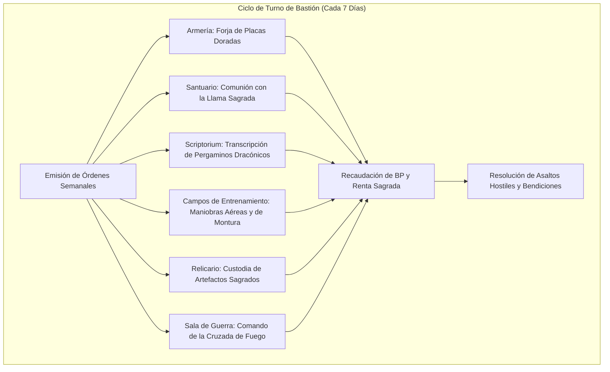

# 🏰 Bastión y Tiempo Muerto — Warrior of Flame

## 🏰 Sistema de Bastiones (Reglas Oficiales DMG 2024 / D&D 5.5e)

*Estructura de gestión de la base de operaciones, economía de bastión y mecánicas de mando.*

* **Nombre del Bastión:** El Bastión de la Flama Sagrada (Phoenix Keep)
* **Nivel de Bastión (Bastion Level):** 20
* **Puntos de Bastión (Bastion Points - BP):** 118
* **Puntuación de Mando (Bastion Defender Stats):** +11 al ataque y salvaciones defensivas (STR 15 [+2], DEX 8 [-1], CON 14 [+2], INT 8 [-1], WIS 10 [+0], CHA 20 [+5]).

---

### Instalaciones Básicas (Basic Facilities)

1. **Dormitorio Principal (Bedchambers):** Torre fortificada en la cúspide del bastión con amplios miradores orientados hacia el amanecer para despegar en vuelo directo (*Dragon Wings*).
2. **Gran Salón de Banquetes (Dining Hall):** Mesa señorial de mármol con chimeneas de piedra volcánica talladas con efigies de dragones de oro.
3. **Plaza de Armas y Patio Común (Common Area):** Patio fortificado con suelo de adoquín reforzado para formación de paladines y juramentos sagrados.

---

### Instalaciones Especiales (Special Facilities — Exactamente 6: 4 Roomy + 2 Vast)

#### 1. Armería Gremial (Armory — Roomy, Desbloqueo Nivel 5)
* **Estado:** Activa (Mantener)
* **Tamaño:** Roomy (Espaciosa)
* **Orden de Bastión:** *Equip & Maintain (Equipar a los Cruzados)*
* **Sinergia con el Build:** 🟢 **Excelente**. Forja y mantenimiento de armaduras de placas doradas, espadones flamígeros y escudos heráldicos para los defensores de la flama. Concede +4 a la defensa base del bastión.

#### 2. Santuario Sagrado (Sanctuary — Roomy, Desbloqueo Nivel 5)
* **Estado:** Activa (Mantener)
* **Tamaño:** Roomy (Espaciosa)
* **Orden de Bastión:** *Bless (Bendición y Comunión Sagrada)*
* **Sinergia con el Build:** 🔵 **Indispensable**. Altar consagrado a la devoción y al dragón de oro. Proporciona agua bendita, restaura la reserva de *Lay on Hands* del personaje y otorga ventaja en tiradas de salvación contra maldiciones.

#### 3. Scriptorium Arcano (Scriptorium — Roomy, Desbloqueo Nivel 9)
* **Estado:** Activa (Mantener)
* **Tamaño:** Roomy (Espaciosa)
* **Orden de Bastión:** *Scribe (Transcribir Magia Dracónica)*
* **Sinergia con el Build:** 🟢 **Excelente**. Copiado de pergaminos sagrados y arcanos (*Shield*, *Fireball*, *Haste*, *Counterspell*) a mitad de tiempo y oro.

#### 4. Campos de Entrenamiento Dracónico (Training Grounds — Roomy, Desbloqueo Nivel 9)
* **Estado:** Activa (Mantener)
* **Tamaño:** Roomy (Espaciosa)
* **Orden de Bastión:** *Train (Entrenar Cruzados y Grifos)*
* **Sinergia con el Build:** 🟢 **Excelente**. Instrucción en combate a caballo y maniobras aéreas combinadas con *Dragon Wings*. Otorga al personaje +1d4 a su primera tirada de ataque tras salir del bastión.

#### 5. Relicario Dracónico (Reliquary — Vast, Desbloqueo Nivel 13)
* **Estado:** Activa (Mantener)
* **Tamaño:** Vast (Vasta)
* **Orden de Bastión:** *Empower (Custodia de Reliquias de Oro)*
* **Sinergia con el Build:** 🔵 **Indispensable**. Cámara blindada consagrada a la memoria de dragones solares antiguos. Otorga al personaje inspiración heroica y ventaja en las tiradas de concentración de conjuros durante las primeras 24 horas.

#### 6. Sala de Guerra y Mando de la Cruzada (War Room — Vast, Desbloqueo Nivel 17)
* **Estado:** Activa (Mantener)
* **Tamaño:** Vast (Vasta)
* **Orden de Bastión:** *Mobilize (Comando y Despliegue de Vanguardia)*
* **Sinergia con el Build:** 🔵 **Indispensable**. Cuartel general de la Orden de la Flama. Permite coordinar regimientos de paladines y lanzar ofensivas estratégicas con un bono marcial de mando de +11.

---

### Seguidores y Guarnición (Staff & Garrison)

* **Capataz General (Major Domo):** Paladín Garen (Un veterano devoto de la orden del dragón de oro, incorruptible y estratega formidable).
* **Guarnición Activa:**
  * 16 Caballeros juramentados en armadura pesada y espada bendita.
  * 4 Jinetes de Grifo para patrulla aérea fronteriza.
  * 2 Clérigos forjadores de reliquias y armaduras mágicas.

---

## ⏳ Actividades de Tiempo Muerto (Downtime Activities)

### Prioridad 1: Transcripción de Pergaminos de Fuego y Protección
* **Mecánica Oficial:** DMG 2024 / XGE (Crafting Spell Scrolls).
* **Bonificadores Aplicables:** Útiles de Escribano (+11), Carisma (+5) y suministros del Scriptorium.
* **Objetivo:** Acumular pergaminos de *Shield*, *Haste* y *Revivify* para contingencias críticas de la compañía.

### Prioridad 2: Consagración y Liderazgo Militar
* **Mecánica Oficial:** XGE (Religious Service / Training).
* **Objetivo:** Impartir bendiciones a las milicias locales, ganando favor divino e inspiración religiosa para expediciones en planos infernales.

---

## 🏃‍♂️ Modos de Movimiento, Logística y Viaje

* **Caminar (Walk):** 30 ft.
* **Vuelo Táctico (Fly):** 30 ft. ilimitado sin concentración gracias a *Dragon Wings* (Sorcerer 14).
* **Iniciativa en Viaje:** -1 (o +4 con dote *Alert*).
* **Aura de Protección Pasiva en Viaje:** Todo el grupo a 10 pies viaja protegido con +5 a cualquier tirada de salvación contra emboscadas, climas extremos o peligros ambientales.

---

## 🎭 Reputación y Facciones

1. **La Sagrada Orden de la Llama Dorada:** Gran Comandante del Fuego Celestial. Mando sobre templos filiales y hospicios fortificados.
2. **El Cónclave de Dragones Metálicos:** Reconocido como emisario mortal del linaje de oro; paso libre por santuarios dracónicos.