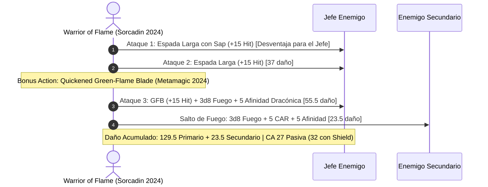

# Guía de Personaje — Warrior of Flame (Edición 2024 / 5.5e Update)

## Datos Generales

* **System Standard:** D&D 5th Edition (2024 Ruleset - 5.5e Compatible)
* **Character Level:** 20 (Total)
* **Class Split:** Sorcerer (Draconic - Gold/Red) 14 / Paladin (Oath of Devotion) 6
* **Species:** Human (2024) [Dotes de Origen: *Alert 2024* y *War Caster 2024*]
* **Background:** Noble / Knight (Atributos: Carisma +2, Fuerza +1)
* **Stats (Point Buy 2024 / Background):**
  * **FUER (STR):** 16 (+3) *(15 Base + 1 Trasfondo; escalable a 25 con Belt of Fire Giant Strength)*
  * **DES (DEX):** 8 (-1)
  * **CON:** 14 (+2)
  * **INT:** 8 (-1)
  * **SAB (WIS):** 10 (+0)
  * **CAR (CHA):** 20 (+5) *(15 Base + 2 Trasfondo + 2 ASI Nivel 10 + 2 ASI Nivel 14)*

* **Enlaces de Documentación:**
  * [Bastión y Tiempo Muerto](file:///d:/repo-vault/Proyectos/Rol/DnDbuilds/builds/warrior%20of%20flame/bastion%20and%20downtime.md)
  * [Lista de Conjuros y Recursos](file:///d:/repo-vault/Proyectos/Rol/DnDbuilds/builds/warrior%20of%20flame/spell%20list.md)
  * [Objetos a Obtener](file:///d:/repo-vault/Proyectos/Rol/DnDbuilds/builds/warrior%20of%20flame/item%20list%20to%20obtain.md)
  * [Hoja de Ruta 1-20](file:///d:/repo-vault/Proyectos/Rol/DnDbuilds/builds/warrior%20of%20flame/roadmap.md)
  * [Inventario Actual](file:///d:/repo-vault/Proyectos/Rol/DnDbuilds/builds/warrior%20of%20flame/actual%20inventory%20list.md)

---

## Combat Role: Fire Gish Striker, Aura Sentinel & Aerial Smite Artillery

Bajo el marco de reglas oficial de **D&D 5.5e (2024)**:
1. **Divine Smite 2024:** Opera como conjuro de acción adicional que inflige daño radiante adicional escalado al impactar.
2. **Innate Sorcery (Hechicero 2024):** Otorga ventaja en todas las tiradas de ataque de conjuros e incrementa la CD de salvación en +1 durante 1 minuto como acción adicional.
3. **Weapon Mastery (Sap en Longsword / Graze en Greatsword):** Impone desventaja en el siguiente ataque del enemigo impactado (*Sap*) o garantiza daño plano mínimo en caso de fallo (*Graze*).
4. **Elemental Affinity (2024):** Añade +5 de daño de fuego a cualquier conjuro que inflija daño ígneo.

---

## 1. Gestión de Recursos y Reglas de Inventario (Reglas 2024)

* **Maestría de Armas (Weapon Masteries 2024):**
  * **Longsword (Sap):** Reduce la letalidad del enemigo imponiendo desventaja en su siguiente golpe.
* **Economía de Ranuras 2024:**
  * Progresión completa de lanzador nivel 17 para alimentar conjuros supremos (*Wish*, *Teleport*, *Hold Monster*).
  * Foco sagrado/arcano unificado integrado en el escudo heráldico.

---

## 2. Action Economy & Combat Loop (2024)

* **Preparación (Pre-Combate):**
  * Activar alas dracónicas (*Dragon Wings* - vuelo libre de 30 pies).
  * Activar *Innate Sorcery* (+1 a la CD de conjuros y ventaja en ataques mágicos) o *Sacred Weapon*.
* **Action:**
  * **Acción de Ataque:** 2 golpes con Espada Larga (+15 a impactar con cinturón y magia). El impacto aplica *Sap* (desventaja para el contraataque enemigo).
* **Bonus Action:**
  * Lanzamiento acelerado con Metamagia (*Quickened Spell*) de *Green-Flame Blade* para realizar un tercer ataque marcial con daño de fuego y salto ígneo adyacente.
  * O detonar *Divine Smite 2024* al impactar.
* **Reaction:**
  * *Shield* (+5 CA hasta el siguiente turno, alcanzando CA 32).
  * *Absorb Elements* (resistencia elemental reactiva).

---

## 3. The META Combo 2024: Innate Sorcery + Sacred Weapon + Elemental Fire Smite

### 🧮 Motor Matemático (2024 Ruleset)

$$\text{Daño Base 2 Ataques de Espada} = 2 \times \left[ 1\text{d}8 + 7 (\text{STR 25}) + 3 (\text{Mágico}) + 5\text{d}8 (\text{Smite}) \right] = \mathbf{74.0 \text{ daño}}$$

$$\text{Daño Quickened Green-Flame Blade} = 1\text{d}8 + 10 + 3\text{d}8 (\text{Fuego}) + 5 (\text{Afinidad}) + 5\text{d}8 (\text{Smite}) = \mathbf{55.5 \text{ daño}}$$

$$\text{Salto Ígneo Secundario} = 3\text{d}8 + 10 = \mathbf{23.5 \text{ daño}}$$

$$\text{DPR Nova Total del Asalto} = 74.0 + 55.5 + 23.5 = \mathbf{153.0 \text{ daño medio total}}$$