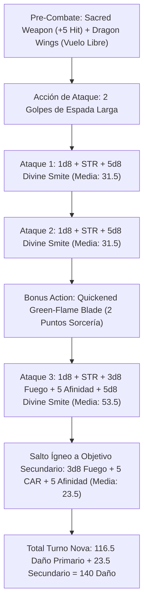

# Guía de Personaje — Warrior of Flame (The Golden Dragon Sorcadin)

## Datos Generales

* **System Standard:** D&D 5th Edition (2024 / 5.5e Update & 2014 Compatibility)
* **Character Level:** 20 (Sorcerer [Draconic Bloodline - Gold] 14 / Paladin [Oath of Devotion] 6)
* **Species:** Variant Human (Dote de Origen: *War Caster* — Lanzador de Conjuros de Guerra)
* **Background:** Noble / Knight (Atributos: Carisma +2, Fuerza +1)
* **Stats (Point Buy + Racial + ASIs):**
  * **FUER (STR):** 15 (+2) *(15 Base — Requisito de Armadura de Placas y multiclase; escalable a 25 con Belt of Fire Giant Strength)*
  * **DES (DEX):** 8 (-1) *(Standard Array)*
  * **CON:** 14 (+2) *(14 Base — Puntos de golpe y concentración)*
  * **INT:** 8 (-1) *(Standard Array)*
  * **SAB (WIS):** 10 (+0) *(Standard Array)*
  * **CAR (CHA):** 20 (+5) *(15 Base + 1 Racial + 2 ASI Nivel 10 + 2 ASI Nivel 14)*

* **Enlaces de Documentación:**
  * [Bastión y Tiempo Muerto](file:///d:/repo-vault/Proyectos/Rol/DnDbuilds/builds/warrior%20of%20flame/bastion%20and%20downtime.md)
  * [Lista de Conjuros y Recursos](file:///d:/repo-vault/Proyectos/Rol/DnDbuilds/builds/warrior%20of%20flame/spell%20list.md)
  * [Objetos a Obtener](file:///d:/repo-vault/Proyectos/Rol/DnDbuilds/builds/warrior%20of%20flame/item%20list%20to%20obtain.md)
  * [Hoja de Ruta 1-20](file:///d:/repo-vault/Proyectos/Rol/DnDbuilds/builds/warrior%20of%20flame/roadmap.md)
  * [Inventario Actual](file:///d:/repo-vault/Proyectos/Rol/DnDbuilds/builds/warrior%20of%20flame/actual%20inventory%20list.md)
  * [Guía de Personaje 2024](file:///d:/repo-vault/Proyectos/Rol/DnDbuilds/builds/warrior%20of%20flame/character%20guide%202024.md)

---

## Combat Role: Aura Frontline Tank, Flying Dragon Gish & Fire Smite Nova

El **Warrior of Flame** es el arquetipo definitivo del **Sorcadin** (Hechicero Dracónico 14 / Paladín de Devoción 6). Combina la armadura pesada y el aura defensiva del Paladín con el motor de lanzamiento de conjuros de nivel 17 (ranuras completas hasta nivel 9, incluyendo *Wish*).

Protege a todo su grupo mediante **Aura of Protection** (+5 a todas las tiradas de salvación dentro de 10 pies), vuela de forma permanente sin gastar conjuros (*Dragon Wings*), y utiliza la metamagia *Quickened Spell* para encadenar 3 impactos devastadores por turno cargados de *Divine Smite* y *Green-Flame Blade* potenciado por Afinidad Elemental Dracónica (+5 daño de fuego plano).

---

## 1. Gestión de Recursos y Reglas de Inventario

* **Economía de Manos y Foco Sagrado/Arcano:**
  * Su escudo de acero lleva grabado el blasón sagrado del dragón de oro, actuando como canalizador mágico universal de Paladín y Hechicero. Gracias a la dote **War Caster**, realiza componentes somáticos y sostiene su espada larga y escudo simultáneamente sin penalizaciones.
* **Gestión de Ranuras Combinadas (Caster Level 17):**
  * Paladín 6 (aporta 3 niveles de lanzador) + Hechicero 14 (aporta 14) = **Nivel de Lanzador 17**.
  * Posee ranuras de conjuro de nivel 1 a nivel 9, utilizables tanto para conjuros arcanos de alta gama (*Wish*, *Teleport*, *Hold Monster*) como para combustible de *Divine Smite* (máximo 5d8 por impacto con ranuras de nivel 4+).
  * **14 Puntos de Sorcería:** Recargables quemando ranuras menores para alimentar *Quickened Spell* (2 puntos) o *Twinned Spell*.

---

## 2. Action Economy & Combat Loop

* **Preparación (Pre-Combate / Turno 0):**
  * Desplegar *Dragon Wings* (acción adicional / movimiento libre).
  * Activar *Sacred Weapon* (Canalizar Divinidad: suma +5 al ataque con armas durante 1 minuto) o lanzar *Shield of Faith* (+2 CA).
* **Action:**
  * **Acción de Ataque (2 Ataques de Espada con Extra Attack):**
    * Ataque 1: Espada Larga (+15 a impactar con *Sacred Weapon* y magia). Al impactar, detona *Divine Smite* de Nivel 4 (+5d8 radiante).
    * Ataque 2: Segundo impacto de espada + *Divine Smite* de Nivel 4 (+5d8 radiante).
* **Bonus Action:**
  * **Quickened Green-Flame Blade (2 Puntos de Sorcería):** Lanza el truco *Green-Flame Blade* como acción adicional, realizando un tercer ataque de espada en la misma ronda. Al impactar, inflige daño de arma + daño de fuego + 5 (Afinidad Dracónica) + un tercer *Divine Smite* (+5d8). El fuego salta a un objetivo secundario infligiendo $3\text{d}8 + 10$ de fuego.
* **Reaction:**
  * 🔵 **Shield:** Suma +5 a la CA de forma reactiva (elevando la CA a 32).
  * 🟢 **Green-Flame Blade (War Caster):** Si un enemigo se retira de su alcance, lanza *Green-Flame Blade* como ataque de oportunidad.
  * 🟢 **Absorb Elements:** Absorbe daño elemental y añade 1d6 de ese elemento al siguiente golpe.

---

## 3. The META Combo: La Espada de la Llama Sagrada (3 Smites + GFB)

### 🧮 Motor Matemático (Mathematical Engine)

#### 1. Cálculo de Daño por Asalto Nova (Con STR 15 Base / STR 25 Cinturón)

Con *Belt of Fire Giant Strength* (STR 25, mod +7) y espada +3:

$$\text{Daño Impactos 1 y 2} = 2 \times \left[ 1\text{d}8 (\text{Arma}) + 7 (\text{STR}) + 3 (\text{Mágico}) + 5\text{d}8 (\text{Smite Nivel 4}) \right] = 2 \times (4.5 + 10 + 22.5) = 2 \times 37.0 = \mathbf{74.0 \text{ daño}}$$

$$\text{Daño Ataque 3 (Quickened GFB)} = 1\text{d}8 + 10 + 3\text{d}8 (\text{Fuego}) + 5 (\text{Afinidad Dracónica}) + 5\text{d}8 (\text{Smite}) = 4.5 + 10 + 13.5 + 5 + 22.5 = \mathbf{55.5 \text{ daño}}$$

$$\text{Daño Salto Ígneo (Objetivo Adyacente)} = 3\text{d}8 + 5 (\text{CAR}) + 5 (\text{Afinidad}) = 13.5 + 10 = \mathbf{23.5 \text{ daño de fuego}}$$

$$\text{DPR Nova Total del Asalto} = 74.0 + 55.5 + 23.5 = \mathbf{153.0 \text{ daño medio total}}$$

#### 2. Fortaleza Defensiva Absoluta y EHP

$$\text{CA Base Pasiva} = 18 (\text{Placas}) + 3 (\text{Mágica +3}) + 2 (\text{Escudo}) + 3 (\text{Escudo +3}) + 1 (\text{Estilo Defensa}) = \mathbf{27 \text{ CA Pasiva}}$$

Al reaccionar con el conjuro *Shield* (+5) o concentrar *Shield of Faith* (+2):

$$\text{Pico de CA Activa} = 27 + 5 + 2 = \mathbf{34 \text{ de CA Máxima}}$$

#### 3. Aura of Protection y Salvaciones de Concentración

$$\text{Bono a Todas las Salvaciones} = +\text{CAR (5)} \text{ a ti y a todos los aliados a 10 ft}$$

Para las tiradas de concentración (Constitución):
$$\text{Salvación de Concentración} = +2 (\text{CON}) + 6 (\text{PB}) + 5 (\text{Aura}) = \mathbf{+13 \text{ con Ventaja (War Caster)}}$$

*Cualquier daño inferior a 28 puntos exige una CD de salvación de 10. Con un bono de +13 y tirando con ventaja, la probabilidad de perder la concentración es matemáticamente **0%**.*

---

## 4. Tabla de Clasificación Táctica de Habilidades

| Habilidad / Recurso | Tipo | Coste | Evaluación | Justificación Táctica |
| :--- | :---: | :---: | :---: | :--- |
| **Aura of Protection** | Soporte/Defensa | Pasiva Paladín 6 | 🔵 | +5 a todas las salvaciones de ti y aliados cercanos; es la habilidad defensiva más rota de 5e. |
| **Quickened GFB** | Ofensiva | 2 Sorcery Points | 🔵 | Otorga un 3.º ataque con daño de fuego dracónico potenciado y smite adicional en la acción adicional. |
| **Dragon Wings** | Movilidad | Pasiva Sorcerer 14 | 🔵 | Vuelo a velocidad de caminar ilimitado sin requerir concentración ni conjuros. |
| **Elemental Affinity** | Pasiva | Sorcerer 6 | 🟢 | Suma +5 al daño de cualquier conjuro de fuego (*Green-Flame Blade*, *Fireball*). |
| **Sacred Weapon** | Ofensiva | 1 Canalizar Divinidad | 🟢 | Añade +5 a las tiradas de ataque con armas durante 1 minuto, garantizando precisión de +15. |
| **Wish** | Utilidad Suprema | Ranura Nivel 9 | 🔵 | Duplica cualquier conjuro de nivel 1 a 8 de cualquier clase sin coste material ni tiempo de casteo. |
| **Shield / Absorb Elements** | Defensiva | Reacción | 🔵 | Eleva la CA a 32 o reduce daño elemental a la mitad. |

---

## 5. Reglas de la Casa (Home Rules)

1. **Escudo Canalizador Unificado:** El blasón sagrado del dragón de oro en el escudo sirve como foco de ambas clases; la dote *War Caster* permite la ejecución de magia con espada y escudo portados.
2. **Ranuras Full Caster para Smite:** La suma de niveles de lanzador otorga espacios de nivel 1 a 9 que pueden consumirse libremente para *Divine Smite* (hasta el tope de 5d8 en ranuras 4+).