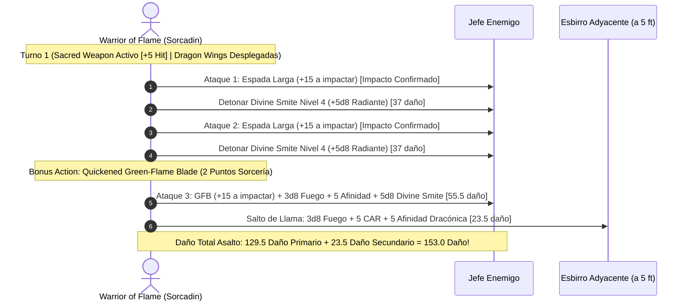

# 🌟 Lista de Conjuros y Recursos Tácticos — Warrior of Flame

El **Warrior of Flame** combina el lanzamiento de conjuros de un **Hechicero Dracónico (14)** con los castigos y bendiciones de un **Paladín de Devoción (6)**, conformando un nivel de lanzador global de **Nivel 17** con acceso a ranuras de nivel 1 a 9 (incluyendo *Wish*).

> **Nota de Regla de Mesa:** El escudo grabado con el blasón dracónico dorado actúa como foco sagrado y arcano universal; con la dote *War Caster*, ejecuta magia con arma y escudo portados.

---

## 🔮 Matriz de Recursos y Salvaciones

* **Nivel Global de Lanzador:** 17 (Full Caster Spell Slots: 4/3/3/3/3/2/2/1/1).
* **Puntos de Sorcería:** 14 por Descanso Largo (para *Quickened Spell*, *Twinned Spell* y *Subtle Spell*).
* **Canalizar Divinidad (Paladín):** 1 uso por Descanso Corto (*Sacred Weapon*: suma +5 al ataque durante 1 minuto).
* **Imposición de Manos (*Lay on Hands*):** 30 Puntos de Golpe por Descanso Largo.
* **CD de Salvación de Conjuros:** $8 + \text{PB (6)} + \text{CAR (5)} = \mathbf{19}$.
* **Bono de Ataque de Conjuro:** $+11$ base (+5 CAR, +6 PB).
* **Aura de Protección:** $+5$ pasivo a todas las tiradas de salvación de ti y de aliados a 10 pies.
* **Turno 0 Pre-Buffs:**
  * Despliegue de alas dracónicas (*Dragon Wings* - vuelo 30 ft ilimitado sin concentración).
  * Activación de *Sacred Weapon* (+5 a impactar con espada) o concentración en *Haste* / *Shield of Faith*.

---

## 🪄 Trucos (Cantrips)

| Conjuro | Escuela | Clasificación | Efecto y Justificación Táctica |
| :--- | :---: | :---: | :--- |
| **Green-Flame Blade** | Evocación | 🔵 | **El pilar del combo:** Inflige daño de arma + $3\text{d}8$ de fuego + 5 (Afinidad Dracónica), y salta a un segundo enemigo infligiendo $3\text{d}8 + 10$ de fuego. Acelerable con *Quickened Spell*. |
| **Fire Bolt** | Evocación | 🟢 | $4\text{d}10 + 5$ de fuego a 120 pies; opción de hostigamiento a distancia beneficiada por Afinidad Dracónica. |
| **Shocking Grasp** | Evocación | 🟢 | Ataque eléctrico cuerpo a cuerpo con ventaja contra armaduras metálicas que anula las reacciones del enemigo. |
| **Light** | Evocación | 🟡 | Ilumina la espada o escudo con luz sagrada. |
| **Prestidigitation** | Transmutación | 🟡 | Efectos ambientales menores para encender antorchas o limpiar armaduras. |

---

## 🎒 Conjuros Preparados y Conocidos

### Nivel 9 (1 Ranura)

| Conjuro | Concentración | Clasificación | Efecto y Justificación Táctica |
| :--- | :---: | :---: | :--- |
| **Wish** | No | 🔵 | **Poder Absoluto:** Duplica cualquier conjuro de nivel 1 a 8 de cualquier lista (incluyendo *Simulacrum*, *Clone*, *Heal* o *Resurrection*) sin consumir tiempo ni componentes materiales. |

### Niveles 7 y 8 (1 Ranura de cada nivel)

| Conjuro | Nivel | Concentración | Clasificación | Justificación Táctica |
| :--- | :---: | :---: | :---: | :--- |
| **Crown of Stars** | 7.º | No (1 hora) | 🔵 | Genera 7 motas de luz estelar; permite disparar una mota como acción adicional cada asalto para infligir $4\text{d}12$ de daño radiante sin concentración. |
| **Teleport** | 7.º | No | 🟢 | Evacuación o transporte instantáneo de todo el grupo a cualquier punto del plano material. |
| **Delayed Blast Fireball** | 7.º | Sí | 🟡 | Detonación ígnea programada que escala hasta $17\text{d}6 + 5$ de fuego dracónico. |

### Niveles 5 y 6 (3 Ranuras Lvl 5 / 2 Ranuras Lvl 6)

| Conjuro | Concentración | Clasificación | Efecto y Justificación Táctica |
| :--- | :---: | :---: | :--- |
| **Hold Monster** | Sí | 🔵 | Paraliza a una criatura de cualquier tipo. Todos los ataques de espada a menos de 5 pies son **críticos automáticos**, multiplicando el daño de *Divine Smite*. |
| **Wall of Light** | Sí | 🟢 | Muro radiante que ciega enemigos y permite proyectar rayos de luz cegadora de $4\text{d}8$ como acción adicional. |
| **Chain Lightning** | No | 🟢 | Descarga eléctrica masiva de $10\text{d}8$ a 4 objetivos para limpiar esbirros de soporte. |

### Niveles 3 y 4 (3 Ranuras Lvl 3 / 3 Ranuras Lvl 4)

| Conjuro | Concentración | Clasificación | Efecto y Justificación Táctica |
| :--- | :---: | :---: | :--- |
| **Fireball** | No | 🔵 | $8\text{d}6 + 5$ de fuego dracónico en radio de 20 pies; ideal para limpiar hordas. |
| **Haste** | Sí | 🔵 | +2 a la CA, doble velocidad y 1 ataque de arma adicional por turno. Blindado contra caídas de concentración gracias a *War Caster* y *Aura of Protection* (+13 CON). |
| **Counterspell** | No (Reacción) | 🔵 | Interrupción inmediata de conjuros enemigos para proteger a los aliados en vanguardia. |
| **Greater Invisibility** | Sí | 🟢 | Ventaja en todos tus ataques y desventaja en ataques enemigos durante 1 minuto. |
| **Revivify (Paladin)** | No | 🟢 | Resurrección inmediata de un compañero caído antes de 1 minuto. |

### Niveles 1 y 2 (4 Ranuras Lvl 1 / 3 Ranuras Lvl 2)

| Conjuro | Concentración | Clasificación | Efecto y Justificación Táctica |
| :--- | :---: | :---: | :--- |
| **Shield** | No (Reacción) | 🔵 | +5 a la CA reactivo (elevando la armadura pasiva a 32). |
| **Absorb Elements** | No (Reacción) | 🔵 | Resistencia a daño elemental imprevisto y $+1\text{d}6$ elemental a tu siguiente golpe. |
| **Misty Step** | No (Bonus Action) | 🟢 | Teletransporte de 30 pies para recolocación instantánea. |
| **Mirror Image** | No | 🟢 | Tres copias defensivas que desvían impactos sin consumir concentración. |
| **Aid (Paladin)** | No (8 horas) | 🟢 | +5 PG máximos a 3 criaturas; escalable a niveles altos. |
| **Shield of Faith (Paladin)** | Sí | 🟢 | +2 a la CA para alcanzar CA 34 combinada con *Shield*. |

---

## ⚡ Metamagia Activa (14 Puntos de Sorcería)

* **Quickened Spell (2 Puntos):** Transforma cualquier conjuro de acción en acción adicional. Fundamental para acelerar *Green-Flame Blade* o un *Hold Monster* y atacar en el mismo turno.
* **Twinned Spell (Variable):** Permite duplicar conjuros de objetivo único como *Haste* o *Greater Invisibility* sobre ti y un aliado marcial simultáneamente.
* **Subtle Spell (1 Punto):** Permite lanzar conjuros sin componentes verbales ni somáticos, contrarrestando *Counterspell* enemigo y operando bajo *Silence*.

---

## 💥 Secuencia de Combate Nova (Sacred Weapon + 3 Smites + Quickened GFB)

---

## 🩺 Curación en Segundo Plano y Mantenimiento Vital

1. **Imposición de Manos (*Lay on Hands*):**
   * Reserva de **30 Puntos de Golpe** que cura sin tiradas o cura enfermedades y venenos gastando 5 puntos por afección.
2. **Cure Wounds y Aid:**
   * Ranuras menores de nivel 1 y 2 disponibles para sostener la vitalidad aliada antes de descansar.
3. **Santuario Sagrado del Bastión:**
   * La capilla del bastión suministra 3 *Potions of Supreme Healing* ($10\text{d}4 + 20 \text{ PG}$) y frascos de agua bendita para contingencias prolongadas.